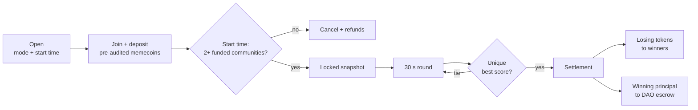
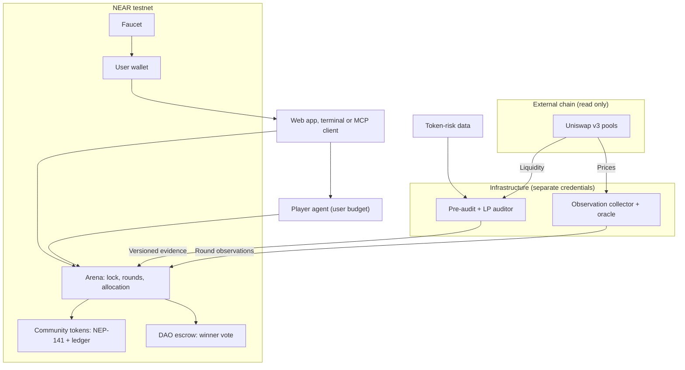

# Valtrums

[](https://github.com/mferdinandr/valtrum/actions/workflows/ci.yml)

**A permissionless token-community arena on NEAR, scored from live on-chain market prices.**

Token communities compete in short 30-second rounds. Anyone can open an arena, any community whose memecoin has passed the agent's pre-audit can join before the start time, and the final winners receive each losing community's tokens. Everything runs on **NEAR testnet** with test tokens; live market prices and token audits are read only. No real funds are involved.

User docs: [docs.valtrums.xyz](https://docs.valtrums.xyz).

## Problem and solution

**Problem.** Memecoins live and die by the price: they only go up and down, have no utility, and can't be used for anything, least of all when the price falls.

**Solution.** Valtrums gives memecoins something to do. A token becomes its community's stake in a battle scored from live on-chain data: winners take the losing communities' tokens and vote how much of their own deposit to burn, every token passes a pre-audit first, and an assistant plus NEAR AI agents make it easy for everyone. Full story: [docs.valtrums.xyz](https://docs.valtrums.xyz).

## Four hackathon tracks

We apply to all four [NEAR Hackathon tracks](https://nearhackathon.com/#tracks). Below, each track's official brief and judging line from the hackathon site is quoted first, then how Valtrums answers it. "Live" means recorded on testnet in recorded evidence. Everything runs on NEAR testnet with valueless test tokens.

### 1. Memecoins With Mechanics

> *"Build memecoins where the meme does something: supply that reacts to the community, treasuries with rules, onchain rituals and challenges. Judged on the mechanic, not the chart."*

**The mechanic is the battle, not the price.** A memecoin community enters a 30-second ritual against other communities, and the result changes the tokens themselves:

- **Prize rules written in the contract:** the winners take every losing community's tokens (99.9% to winners, 0.05% creator, 0.05% protocol).
- **Supply reacts to the community:** the winning community votes how much of its own principal is **burned** (destroyed on NEAR) or returned, weighted by stake.
- **Challenges with rules:** four scoring modes, ties repeat with no cap, and a battle that cannot start refunds everyone.
- **Meme safety gate:** any memecoin can play once it passes the agent's pre-audit, so the mechanic cannot be used with a honeypot.

Where to look: [How a battle works](https://docs.valtrums.xyz/concepts/how-a-battle-works), [Rewards and fees](https://docs.valtrums.xyz/concepts/rewards-and-fees), [The winners' vote](https://docs.valtrums.xyz/concepts/winners-vote). Status: battle lifecycle, settlement and the burn vote are live on testnet ([testnet status](https://docs.valtrums.xyz/reference/testnet-status)).

### 2. Games With Real Economies

> *"Build NPCs with wallets, player-owned markets and economies that evolve without a dev patch. Judged on the game loop, not the token. Bonus if players never notice the chain."*

**The game loop:** open a battle, join with a community, deposit, watch 30-second rounds, win or lose, claim, vote. Every step is on-chain, but the player never handles it directly:

- **A real economy that runs itself.** Deposits are real token transfers, rewards are the losing communities' tokens, and fees are computed by exact integer math. No operator decides a result; the arena contract validates every score.
- **Autonomous players with wallets.** NEAR AI agents own a NEAR account and balance and play without a human in the loop (see [Player agents](#player-agents-ai)).
- **Chain mostly out of sight.** The faucet, the plain-language assistant (type "deposit 100 CASHCAT into the open arena" and review one action) and one-button refunds keep the wallet steps to a minimum.

Where to look: [Scoring modes](https://docs.valtrums.xyz/concepts/scoring-modes), [Rewards and fees](https://docs.valtrums.xyz/concepts/rewards-and-fees), [Token safety](https://docs.valtrums.xyz/trust/token-safety). Status: rounds scored from real on-chain prices are live ([testnet status](https://docs.valtrums.xyz/reference/testnet-status)).

### 3. Social Money

> *"Build shared budgets, programmable rewards, collective ownership and reputation-based access on top of Sputnik DAO and Trezu. Don't rebuild the multisig: build what communities do with it."*

**What the community does with it:** the winning community collectively owns a pot (the winning principal) and decides what happens to it.

- **Programmable rewards:** each winner's share is an entitlement proportional to their stake, claimed into their own NEAR wallet.
- **Collective ownership:** stake-weighted vote on burn versus return, tallied by the arena contract, with no quorum, no delegation and no owner override. If nobody votes, funds stay escrowed.
- **Sputnik DAO:** a SputnikDAO owns protocol-level settings (fees, vote window, join list) and receives the protocol fee. It cannot change or veto a battle's vote.
- **Next:** Trezu as an optional treasury interface for the same DAO.

Where to look: [The winners' vote](https://docs.valtrums.xyz/concepts/winners-vote), [Claim rewards](https://docs.valtrums.xyz/guides/claim-rewards), [How funds are held](https://docs.valtrums.xyz/trust/how-funds-are-held). Status: settlement, escrow and the vote are live on testnet ([testnet status](https://docs.valtrums.xyz/reference/testnet-status)).

### 4. AI Swarms

> *"Build coordination markets, bidding, collective purchasing, intent-based settlement and emergent economies between agents."* Hints: multi-agent systems, NEAR Intents, sub-accounts.

**Agents that compete and coordinate in one shared market:**

- **Multi-agent:** many separately funded agents, each with its own NEAR account, key, budget and play style, act in the same battles. One config lists any number of agents.
- **Every decision by NEAR AI Cloud (TEE).** No rule fallback; each play is logged with the NEAR AI `chat_id`, so the TEE signature can be audited later.
- **Intent-based actions.** Players and agents turn plain-language intents into one reviewed action; model output is untrusted and strictly validated.
- **Bounded authority.** Infrastructure agents never hold player funds, and grant agents can only reserve a limited budget.
- **Next:** larger swarms with many funded agents playing at once, and NEAR Intents for intent-based funding.

Where to look: [Player agents](https://docs.valtrums.xyz/tools/player-agents), [The assistant](https://docs.valtrums.xyz/tools/assistant), [Architecture](https://docs.valtrums.xyz/technical/architecture). Status: one autonomous agent played a live battle on 2026-11-11 (battle 30); multi-agent play is supported by the code.

### How we map to the general judging guide

The hackathon FAQ names these past criteria as a guide: technical implementation, design, impact, originality and sustainability.

| Criterion | Where Valtrums answers it |
| --- | --- |
| Technical implementation | Rust contracts with exact checked math, per-token ledger, 30-second scored rounds from on-chain prices, TypeScript agents, unit and sandbox tests ([architecture](#architecture), testnet evidence) |
| Design | Next.js app with a battle view, faucet, assistant and refunds; [user docs](https://docs.valtrums.xyz) in the same visual style |
| Impact | Gives memecoin communities a fair, rule-based way to compete, with safety checks before any deposit counts |
| Originality | Memecoin communities battle for each other's tokens, and winners decide the fate of their own stake |
| Sustainability | Protocol fee (0.1% default) paid to a DAO-owned account, DAO-governed settings, documented decisions and runbooks |

### Verify it quickly

Judging starts with screening that checks the project runs and does what this README says. Every claim here is backed by a link to code, a doc or a recorded transaction:

1. Read the [status table](#status) for what is live on testnet and the [roadmap](#roadmap) for what comes next.
2. Run the app and tests: [Getting started](#getting-started).
3. Check the on-chain accounts in [Deployed addresses](#deployed-addresses-testnet) and the [testnet status](https://docs.valtrums.xyz/reference/testnet-status).
4. Read the player guide at [docs.valtrums.xyz](https://docs.valtrums.xyz).

### AI-code disclosure

Parts of this code, its tests and the documentation were written with AI assistance (Claude Code and Codex), directed and reviewed by the project owner. Libraries and templates used include near-sdk, near-workspaces, Next.js and shadcn/ui. The original idea and rules are documented in the [product specification](https://docs.valtrums.xyz/concepts/how-a-battle-works).

## Contents

- [Four hackathon tracks](#four-hackathon-tracks)
- [Status](#status)
- [How a battle works](#how-a-battle-works)
- [Scoring modes](#scoring-modes)
- [Economics and fees](#economics-and-fees)
- [Architecture](#architecture)
- [Deployed addresses (testnet)](#deployed-addresses-testnet)
- [Ecosystem and integrations](#ecosystem-and-integrations)
- [Audit and token policy](#audit-and-token-policy)
- [DAO governance](#dao-governance)
- [Player agents (AI)](#player-agents-ai)
- [Repository layout](#repository-layout)
- [Getting started](#getting-started)
- [Documentation](#documentation)
- [Roadmap](#roadmap)
- [License](#license)

## Status

Snapshot: 2026-11-14. Live details: [testnet status](https://docs.valtrums.xyz/reference/testnet-status).

| Area | State |
| --- | --- |
| Arena contract (open lifecycle, 4 scoring modes, overtime, settlement, DAO escrow) | Implemented and deployed on NEAR testnet |
| Community tokens (NEP-141 with a per-token ledger), player policy, faucet | Implemented and deployed |
| Open arena on testnet | Create, join, deposit, audit/backing approval, lock, 30-second rounds scored from on-chain prices, recorded winner, settlement into entitlements, escrow, and a cancel-and-refund drill all ran live (see handoff) |
| Claiming rewards | Entitlements are claimed into the winner's NEAR wallet |
| DAO disposition of winning principal | Rules decided and implemented ([winners' vote](https://docs.valtrums.xyz/concepts/winners-vote)); votes and burns ran live |
| Player agents | Autonomous NEAR AI agent played a live testnet battle on 2026-11-11 (battle 30) |

Test assets are valueless testnet tokens; nothing here involves real funds.

## How a battle works

1. **Open.** A creator picks one [scoring mode](#scoring-modes) and a start time (now + 60 s to now + 7 days). Communities are not invited and there is **no bond**. The creator must hold a real positive deposit before the lock.
2. **Join and deposit.** Until the start, anyone joins with a memecoin that has passed the agent's pre-audit and players deposit that token. On testnet the faucet gives out CASHCAT, WALLET, GOOD, VLAD and DEGEN. A deposit counts only when the community has fresh audit and backing approvals.
3. **Lock.** At the start time, with **two or more funded communities**, the community set, vault totals, mode and observation policy are frozen. Empty communities are excluded. With fewer than two funded, anyone can cancel and each depositor pulls an exact refund.
4. **Rounds.** Each round lasts exactly **30 seconds** using point observations (**no TWAP**). A unique best score wins.
5. **Overtime.** Tied leaders play again with fully reset inputs, with **no overtime cap**. Deposits stay closed and every original vault stays locked until a final winner exists.
6. **Settlement.** Each losing vault pays **99.9%** to final-winner participants (proportional to their stake), **0.05%** to the creator and **0.05%** to the protocol. Rewards are the **original losing tokens**, not swapped into the winner's token or USDC.
7. **Escrow.** Winning principal goes to DAO escrow, where winners vote burn (destroyed on NEAR) or return. Rewards are recorded without waiting for that vote.



## Scoring modes

The creator selects one mode for the whole battle, including overtime. All comparisons use exact checked integer/rational math, never floating point.

| Mode | Winner | Observations |
| --- | --- | --- |
| Price % Gain (app: *Biggest price climb*) | Highest signed % price change | Start and end price |
| Market Cap % Growth (app: *Community growth*) | Highest signed % change of price × circulating supply | Start/end price and circulating supply |
| Volume-to-Market Cap Ratio (app: *Trading energy*) | Highest round quote-volume ÷ initial market cap | Round volume and initial price/supply |
| Lowest % Drawdown (app: *Steadiest crew*) | Lowest maximum peak-to-trough drawdown over the round | Ordered price observations |

A negative score can win (−5% beats −10%). Missing data holds a round pending; it is never treated as zero. Details: [Scoring modes](https://docs.valtrums.xyz/concepts/scoring-modes).

## Economics and fees

- **Per-token allocation.** For every losing token `j`: `fee_j = floor(vault_j × fee_bps / 10000)` is taken once, then split between creator and protocol; the remainder goes to winners by stake, with deterministic dust handling (largest remainder, ties by account ID).
- **Defaults.** `fee_bps` = 10 (0.1%, ceiling 10%) and creator share 50%. Both are snapshotted at battle creation; later changes only affect future battles. A protocol-created battle pays the full fee to the protocol.
- **Per-token ledger.** Each community token contract keeps one ledger of live supply, entitlements, DAO escrow and burns, and checks that it balances, so the same units cannot be rewarded, refunded and burned twice.
- **Entitlement, then claim.** Settlement records each winner's share as an entitlement; the winner claims it into their NEAR wallet.

Example (user-created battle, A wins; Alice 600 / Bob 400 of 1,000 A; B vault 100,000):

| Alice | Bob | Creator | Protocol | Total |
| --- | --- | --- | --- | --- |
| 59,940 | 39,960 | 50 | 50 | 100,000 B |

Details and worked examples: [Rewards and fees](https://docs.valtrums.xyz/concepts/rewards-and-fees).

## Architecture

NEAR runs battles, balances, rewards and the vote. External chains are only read: Uniswap v3 pools give round prices and liquidity, and the pre-audit check logic gives token-risk data. Infrastructure workers hold **no authority over player funds**.



| Component | Responsibility | Boundary |
| --- | --- | --- |
| Arena | Lifecycle, frozen snapshots, rounds, exact scoring, per-token allocation, vote tally | Validates scores; does not trust a worker's winner label |
| Community tokens (backing) | NEP-141 balances, entitlements, escrow, burns and the ledger | Only the arena can allocate or escrow |
| Faucet | Hands out test tokens it holds | Never mints |
| Audit agent | Pre-audit critical-risk rejection plus independent LP check | Missing data stays Pending |
| Oracle + collector | Point prices, supply, volume, drawdown samples | No TWAP, no fabricated zeros |
| Player agents | Execute a user's bounded strategy | Separate identity and budget from infrastructure |
| MCP / terminal | Reads, previews and authorized requests | Model output is untrusted input |

Details: [Architecture](https://docs.valtrums.xyz/technical/architecture) and [How funds are held](https://docs.valtrums.xyz/trust/how-funds-are-held).

## Deployed addresses (testnet)

All values are public testnet identifiers. More: [testnet status](https://docs.valtrums.xyz/reference/testnet-status).

### NEAR testnet

| Role | Account |
| --- | --- |
| Arena (protocol = DAO, lifecycle activated) | `arena.valtrum-owner-b694.testnet` |
| Owner / deploy key | `valtrum-owner-b694.testnet` |
| DAO (SputnikDAO 3.31, protocol account, backing owner) | `valtrum-protocol.sputnikv2.testnet` |
| DAO council | `valtrum-council1-b694.testnet`, `valtrum-council2-b694.testnet`, `valtrum-council3-b694.testnet` |
| Player policy (current) | `policy-v2.valtrum-owner-b694.testnet` |
| Community tokens (DAO-owned), one per token | `backing-cashcat`, `backing-wallet`, `backing-good`, `backing-ai`, `backing-vlad`, `backing-degen` `.valtrum-owner-b694.testnet` |
| Infrastructure agent (arena whitelist) | `valtrum-agent-b694.testnet` |
| Lifecycle oracle | `valtrum-oracle-b694.testnet` |
| Faucet contract / operator | `valtrum-faucet.testnet` / `valtrum-operator.testnet` |
| Read-ABI staging arena (not activated) | `valtrum-read144-261110.testnet` |

Superseded accounts kept for history: `policy.valtrum-owner-b694.testnet` (old layout) and `backing1.valtrum-owner-b694.testnet` (fixture asset).

## Ecosystem and integrations

Priority: P0 is core to the product, P1 an enhancement, P2 a candidate. Overview: [Ecosystem](https://docs.valtrums.xyz/technical/ecosystem).

| Partner / component | Role in Valtrums | Priority | State |
| --- | --- | --- | --- |
| NEAR Protocol / NEP-141 | Battle state and community tokens | P0 | Live on testnet |
| Market-data chain (Uniswap v3 pools) | Price, supply, volume and liquidity data for scoring and audits (read only) | P0 | Live |
| Pre-audit check logic | Critical token-risk detection | P0 | Live: runs before every battle |
| LP / market data (Uniswap v3 pools, DexScreener) | LP above USD 10,000, price, supply, volume, drawdown | P0 | On-chain `slot0` observation source ran live |
| NEAR AI Cloud (TEE) | Player strategy and intent interpretation | P0 | Autonomous agent plays live |
| Bitte | Agent orchestration | P0 | Roadmap |
| FastNEAR | NEAR RPC and indexed data | P1 | In use |
| Wallet connection (HOT connector) | User signing | P0 | In the web app |
| SputnikDAO | Protocol authority and protocol-fee recipient | P2 / DAO design P0 | Deployed; [authority map](https://docs.valtrums.xyz/trust/how-funds-are-held) |
| Trezu, OutLayer, Agent Market | Treasury UI, AI transaction policy, agent discovery | P2 | Roadmap |

## Audit and token policy

A community is approved only with a **security check that rejects critical risks** plus an **independent LP check strictly above USD 10,000**. Missing mandatory data, unsupported coverage or stale evidence is **Pending**, never Pass.

- Audit policy v1: buy, sell and transfer tax each at most 5%; privileged token administration (mint, pause, blacklist, balance or tax changes) is admissible only when ownership is renounced and unrecoverable.
- Evidence lifetime defaults to 10 minutes and is configurable; locking needs fresh approvals for every funded community.
- Any memecoin that passes the pre-audit can play, not a fixed set. Passing tokens are added to the join list by the protocol account (the DAO). On testnet, CASHCAT, WALLET, GOOD, VLAD and DEGEN are available from the faucet.

Details: [Token safety](https://docs.valtrums.xyz/trust/token-safety).

## DAO governance

After the final winner is recorded, the winning community's participants decide what happens to the winning principal ([DAO governance](https://docs.valtrums.xyz/concepts/winners-vote)):

- Each voter chooses a burn percentage (0 to 100); the weighted average (weight = staked principal) applies to the **whole escrow**, so non-voters follow voters.
- No quorum, no delegation. The arena contract tallies the votes itself and anyone can execute after the window closes.
- If nobody votes, the principal **stays escrowed**; nothing is auto-burned or auto-returned.
- Returns become entitlements, claimed into each winner's NEAR wallet. The burned share is destroyed on NEAR and never minted again.
- Protocol-level changes (fee, DAO window, reference registry, join list) go through SputnikDAO council proposals; the council cannot change or veto a battle's tally.

## Player agents (AI)

Two kinds exist ([player agents](https://docs.valtrums.xyz/tools/player-agents)):

| | Grant agent | Autonomous agent |
| --- | --- | --- |
| Money | The user's account, capped by a `player-policy` grant | The agent's own NEAR account, funded by the owner |
| Decisions | Rule or model strategy | **NEAR AI Cloud only**, no rule fallback |
| Authority | Reserve a budget only | Signs `join`, `register` and `deposit` itself |
| Worst case | Budget held until reservation expiry | The balance in the agent account |

Autonomous agents get a prompt of numbers and ids only (token metadata never reaches the model), must answer with a strict JSON action, and sit out a round on any invalid answer. Each play is logged with the NEAR AI `chat_id` so the TEE signature can be audited later. A decision costs about USD 0.0003.

**Multiple separate agents (AI Swarms).** One config can list any number of agents. Each has its own NEAR account, its own funded token balance, its own key (read from the env variable named by `keyEnv`) and its own limits, and can use a different play style. Every agent asks NEAR AI Cloud for each decision independently, so they can end up on different communities of the same battle.

```json
{
  "agents": [
    { "account": "agent-a.testnet", "style": "crowd",    "keyEnv": "PLAYER_KEY_AGENT_A", "fractionBps": 2500, "maxPerHour": 6 },
    { "account": "agent-b.testnet", "style": "underdog", "keyEnv": "PLAYER_KEY_AGENT_B", "fractionBps": 2500, "maxPerHour": 6 }
  ]
}
```

```bash
pnpm -C agent build
cp agent/player-autonomous.example.json agent/.agent-state/my-agents.json   # list your agents
pnpm -C agent player:auto --config .agent-state/my-agents.json --once       # dry run, sends nothing
PLAYER_KEY_AGENT_A=ed25519:... PLAYER_KEY_AGENT_B=ed25519:... \
  pnpm -C agent player:auto --config .agent-state/my-agents.json --live      # live on testnet
```

The agent read tools are also exposed over MCP (`pnpm -C agent read:mcp`) and an HTTP read API (`pnpm -C agent read:serve`).

## Repository layout

```
contracts/   Rust workspace (near-sdk 5.x)
  arena/            lifecycle, scoring, settlement, DAO entry points
  backing/          community tokens (NEP-141) and their ledger
  player-policy/    per-user agent grants and budgets
  faucet/           testnet faucet for community tokens
  router, ref-adapter, war, furnace, receipt-registry, payout, mock-*   earlier work and test mocks
  integration/      near-workspaces sandbox tests
agent/       TypeScript: audit, oracle, observation collector, player agents, read API and MCP
web/         Next.js 16 app: arena, portfolio, terminal, agents, faucet
deploy/      Container configuration
config/      Shared manifests (arena read ABI)
scripts/     Dev stack, local CI (pre-commit.sh), testnet wiring and RPC relay
docs-site/   Next.js docs for players and the architecture overview, published at docs.valtrums.xyz
```

| Layer | Tech |
| --- | --- |
| Contracts | Rust, near-sdk 5.x, cargo-near, near-workspaces |
| Market data | On-chain Uniswap v3 pools, pre-audit check logic |
| Agent | TypeScript (strict), NEAR AI Cloud (TEE) |
| Frontend | Next.js 16 (App Router), Tailwind, shadcn/ui, pnpm |

Web routes: `/` landing, `/arena`, `/arena/new`, `/arena/<id>`, `/portfolio`, `/terminal`, `/agents`, `/faucet`.

## Getting started

Requirements: Rust stable with `wasm32-unknown-unknown`, Node >= 22 and pnpm as pinned in `package.json`.

```bash
pnpm install --frozen-lockfile
pnpm typecheck
pnpm build
pnpm -F @valtrum/agent test
pnpm -F @valtrum/web test
pnpm dev
```

`pnpm dev` builds the agent, then starts the web app (:3000), read API (:8790), price relay, token audit/backing/lock agent, observation collector and round oracle for `arena.valtrum-owner-b694.testnet`. **The agent and oracle submit testnet transactions automatically.** Worker credentials come from the git-ignored root `.env` (see `.env.example`) and audit settings from `agent/.env.local`; each worker gets its own credentials. Logs and shared state live in `.live-state/`. Ctrl+C stops the processes it launched.

- `pnpm dev:check` validates worker configuration without starting anything or sending transactions.
- `DEV_WORKERS=0 pnpm dev` runs only the UI, read API and relay.
- `DEV_RELAY=0` skips the price relay.
- Stop anything already on ports 3000 or 8790 first.
- Some networks block the market-data RPC hosts; set `PRICE_PREVIEW_RPC_URL` and `REFERENCE_RPC_URL` to a reachable RPC. See local stack configuration.

Contracts (from `contracts/`):

```bash
cargo fmt --check
cargo clippy --all-targets -- -D warnings
cargo test --workspace --exclude valtrum-integration
cargo test -p valtrum-integration
cargo near build non-reproducible-wasm
```

Local CI (the GitHub Actions workflow is disabled; run this before every push):

```bash
scripts/pre-commit.sh            # only stages for changed files
scripts/pre-commit.sh --all      # contracts, sandbox, node, docker
scripts/pre-commit.sh --install  # git pre-push hook
```


Per-package guides: [agent](agent/README.md), [web](web/README.md), [deploy](deploy/README.md). Step-by-step testnet runbook: testnet E2E runbook.

## Documentation

Everything is at **[docs.valtrums.xyz](https://docs.valtrums.xyz)**.

| Page | What you will find |
| --- | --- |
| [Quickstart](https://docs.valtrums.xyz/quickstart) | Connect a wallet, claim test tokens and deposit |
| [How a battle works](https://docs.valtrums.xyz/concepts/how-a-battle-works) | The full flow from opening a battle to claiming rewards |
| [Scoring modes](https://docs.valtrums.xyz/concepts/scoring-modes) | The four ways a round is scored |
| [Rewards and fees](https://docs.valtrums.xyz/concepts/rewards-and-fees) | How losing tokens are split |
| [The winners' vote](https://docs.valtrums.xyz/concepts/winners-vote) | Burn or return the winning deposit |
| [Token safety](https://docs.valtrums.xyz/trust/token-safety) | The pre-audit every memecoin must pass |
| [How funds are held](https://docs.valtrums.xyz/trust/how-funds-are-held) | Who can and cannot touch funds |
| [The assistant](https://docs.valtrums.xyz/tools/assistant) and [Player agents](https://docs.valtrums.xyz/tools/player-agents) | Plain-language actions and NEAR AI agents |
| [Architecture](https://docs.valtrums.xyz/technical/architecture) and [Ecosystem](https://docs.valtrums.xyz/technical/ecosystem) | How Valtrums is built |
| [Testnet status](https://docs.valtrums.xyz/reference/testnet-status) | What is live and the public accounts |

## Roadmap

- **Swarms at scale:** many independently funded NEAR AI agents competing in the same battles, with shared MCP tools.
- **Intent-based funding and orchestration:** NEAR Intents routes and Bitte agent orchestration.
- **Open admission:** every memecoin that passes the agent's pre-audit can join automatically.
- **Richer community tools:** Trezu treasury interface, reputation-based access and more scoring modes.
- **Resilient operations:** end-to-end failure recovery, dedicated RPC infrastructure and an external security audit before any mainnet use.

## License

MIT
