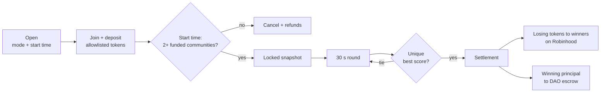
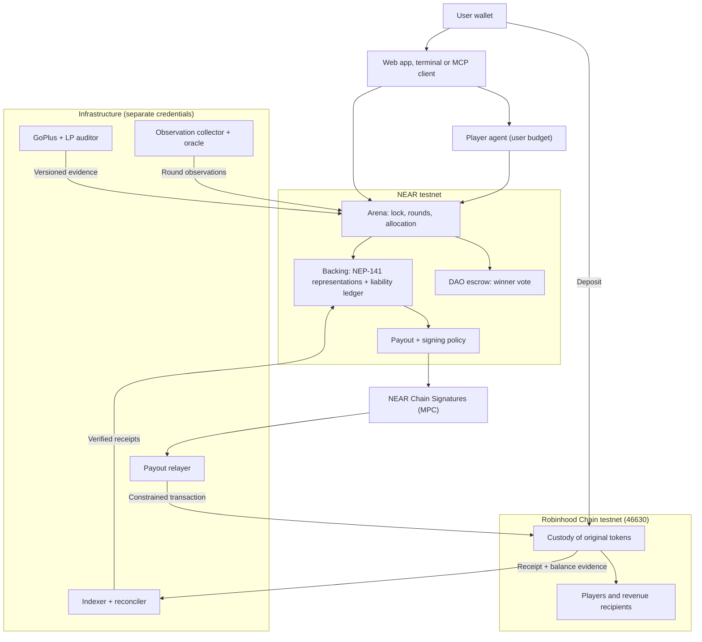

# Valtrum

[](https://github.com/mferdinandr/valtrum/actions/workflows/ci.yml)

**A permissionless token-community arena coordinated on NEAR, with original-token custody and rewards on Robinhood Chain.**

Token communities compete in short 30-second rounds. Anyone can open an arena, any community with an allowlisted token can join before the start time, and the final winners receive each losing community's original token on Robinhood Chain. Everything runs on **NEAR testnet** and **Robinhood Chain testnet**; no mainnet funds are involved.

> **Hackathon:** Valtrum is our entry to the [NEAR Hackathon](https://nearhackathon.com) and applies to **all four tracks**: Memecoins With Mechanics, Games With Real Economies, Social Money and AI Swarms. See [Four hackathon tracks](#four-hackathon-tracks). Development ends 2026-11-14 23:59 UTC.

## Four hackathon tracks

Each track maps to a concrete part of the product. Status is stated plainly; "live" means recorded on testnet in [`docs/evidence/`](docs/evidence).

| Track | What Valtrum does for it | Where to look | Status |
| --- | --- | --- | --- |
| **Memecoins With Mechanics** | Memecoin communities (CASHCAT, WALLET, GOOD, VLAD, DEGEN) battle each other with explicit prize rules: winners take the losing tokens, and winners vote to burn their own principal | [How a battle works](#how-a-battle-works), [Economics](#economics-and-fees), [DAO governance](#dao-governance) | Battle lifecycle live on testnet; burn vote implemented, no live vote yet |
| **Games With Real Economies** | Four scoring modes, locked vaults, 30-second rounds, unlimited overtime on ties, and rewards paid in the real original token, with 1:1 backed representations and an exact liability ledger | [Scoring modes](#scoring-modes), [Economics](#economics-and-fees), [Audit policy](#audit-and-token-policy) | Rounds scored from real on-chain prices live; Robinhood payout not yet proven |
| **Social Money** | Rewards split proportionally among the winning community, and its participants collectively decide the fate of the winning principal (burn or return) by stake-weighted vote, tallied by the contract itself | [DAO governance](#dao-governance), [DAO spec](docs/dao-governance.md) | Settlement into entitlements and DAO escrow live; vote execution untested live |
| **AI Swarms** | Several user-funded NEAR AI agents, each with its own account and budget, play the shared arena; every decision comes from NEAR AI Cloud (TEE) and is auditable by `chat_id`; shared read tools are exposed over MCP | [Player agents](#player-agents-ai), [player agents spec](docs/player-agents.md) | One autonomous agent played a live battle (2026-11-11); multi-agent play is supported by the code; a recorded run with several funded agents is still to be added |

How each track is satisfied:

- **Memecoins With Mechanics.** Tokens are admitted only through the audit gate and the allowlist, so a battle cannot be opened with a honeypot. Battle outcome has real consequences for the token: losing vaults move to winners, and the winning side can burn its own supply (sent to a verified sink).
- **Games With Real Economies.** Nothing is a points game: deposits are real custody receipts, winners receive the original tokens, and fees (0.1% by default) are computed with exact integer math. A battle that cannot start (fewer than two funded communities) refunds every depositor.
- **Social Money.** The community, not an operator, decides what happens to the winning principal. There is no owner override, no quorum gate and no delegation; if nobody votes, funds stay escrowed rather than being auto-moved.
- **AI Swarms.** Infrastructure agents (audit, oracle, relayer) never hold authority over player funds. Player agents act only with their own balance or a bounded grant, and model output is treated as untrusted input that must pass strict validation.

These are our selected [NEAR Hackathon tracks](https://nearhackathon.com/#tracks). AI Swarms needs more than one independently funded agent: the code supports it, and we only claim it as complete once a multi-agent run is recorded.

## Contents

- [Four hackathon tracks](#four-hackathon-tracks)
- [Status](#status)
- [How a battle works](#how-a-battle-works)
- [Scoring modes](#scoring-modes)
- [Economics and fees](#economics-and-fees)
- [Architecture](#architecture)
- [Deployed addresses (testnet)](#deployed-addresses-testnet)
- [Ecosystem and integrations](#ecosystem-and-integrations)
- [Audit and token policy](#audit-and-token-policy)
- [DAO governance](#dao-governance)
- [Player agents (AI)](#player-agents-ai)
- [Repository layout](#repository-layout)
- [Getting started](#getting-started)
- [Documentation](#documentation)
- [Known gaps](#known-gaps)
- [License](#license)

## Status

Snapshot: 2026-11-13. Full detail in [current state](docs/current-state.md), [testnet evidence](docs/testnet-evidence.md) and the [implementation tracker](docs/implementation-tracker.md).

| Area | State |
| --- | --- |
| Arena contract (open lifecycle, 4 scoring modes, overtime, settlement, DAO escrow) | Implemented and deployed on NEAR testnet |
| Backing (1:1 NEP-141), receipt registry, payout, player policy, faucet | Implemented and deployed |
| Robinhood testnet custody (forwarder) and six mock tokens | Deployed; six custody deposits verified end to end and minted |
| Open arena on testnet | Create, join, deposit, audit/backing approval, lock, 30-second rounds scored from on-chain prices, recorded winner, settlement into entitlements, escrow, and a cancel-and-refund drill all ran live (see [handoff](docs/handoff-live-run.md)) |
| Robinhood payout of winnings | Code exists; **not yet proven** on testnet (needs spendable custody, #148) |
| DAO disposition of winning principal | Rules decided ([D22](docs/dao-governance.md)) and implemented; no live vote yet |
| Player agents | Autonomous NEAR AI agent played a live testnet battle on 2026-11-11 (battle 30) |
| NEAR Intents funding | Labeled **fixture** only; Robinhood testnet routes are not offered by 1Click |

Test assets are fixtures (mock tokens with no value). Only recorded observations under [`docs/evidence/`](docs/evidence) are live-network evidence.

## How a battle works

1. **Open.** A creator picks one [scoring mode](#scoring-modes) and a start time (now + 60 s to now + 7 days). Communities are not invited and there is **no bond**. The creator must hold a real positive deposit before the lock.
2. **Join and deposit.** Until the start, anyone joins with a protocol-allowlisted token (**CASHCAT, WALLET, GOOD, VLAD, DEGEN**) and players deposit that token. A deposit counts only after verified custody receipt and only when the community has fresh audit and backing approvals.
3. **Lock.** At the start time, with **two or more funded communities**, the community set, vault totals, mode and observation policy are frozen. Empty communities are excluded. With fewer than two funded, anyone can cancel and each depositor pulls an exact refund.
4. **Rounds.** Each round lasts exactly **30 seconds** using point observations (**no TWAP**). A unique best score wins.
5. **Overtime.** Tied leaders play again with fully reset inputs, with **no overtime cap**. Deposits stay closed and every original vault stays locked until a final winner exists.
6. **Settlement.** Each losing vault pays **99.9%** to final-winner participants (proportional to their stake), **0.05%** to the creator and **0.05%** to the protocol. Rewards are the **original losing tokens**, not swapped into the winner's token or USDC.
7. **Escrow.** Winning principal goes to DAO escrow, where winners vote burn or return. Rewards never wait for that vote.



## Scoring modes

The creator selects one mode for the whole battle, including overtime. All comparisons use exact checked integer/rational math, never floating point.

| Mode | Winner | Observations |
| --- | --- | --- |
| Price % Gain | Highest signed % price change | Start and end price |
| Market Cap % Growth | Highest signed % change of price × circulating supply | Start/end price and circulating supply |
| Volume-to-Market Cap Ratio | Highest round quote-volume ÷ initial market cap | Round volume and initial price/supply |
| Lowest % Drawdown | Lowest maximum peak-to-trough drawdown over the round | Ordered price observations |

A negative score can win (−5% beats −10%). Missing data holds a round pending; it is never treated as zero. Formulas, worked examples and overtime rules: [battle rules](docs/battle-rules.md) and [scoring market data](docs/scoring-market-data.md).

## Economics and fees

- **Per-token allocation.** For every losing token `j`: `fee_j = floor(vault_j × fee_bps / 10000)` is taken once, then split between creator and protocol; the remainder goes to winners by stake, with deterministic dust handling (largest remainder, ties by account ID).
- **Defaults.** `fee_bps` = 10 (0.1%, ceiling 10%) and creator share 50%. Both are snapshotted at battle creation; later changes only affect future battles. A protocol-created battle pays the full fee to the protocol.
- **1:1 backing.** NEP-141 representations on NEAR are minted only for the amount **actually received** in Robinhood custody (never from a declaration or signature), with exclusive reservations so the same backing cannot be redeemed, paid out and burned twice.
- **Ledger invariant.** For each asset `B = M + E + P + D + U` (custody balance = live representations + entitlements + pending payouts + pending DAO disposals + unallocated).
- **Entitlement ≠ payment.** An allocated entitlement and a confirmed Robinhood transfer are distinct states; a signature, RPC acceptance or unfinalized event never counts as paid.

Example (user-created battle, A wins; Alice 600 / Bob 400 of 1,000 A; B vault 100,000):

| Alice | Bob | Creator | Protocol | Total |
| --- | --- | --- | --- | --- |
| 59,940 | 39,960 | 50 | 50 | 100,000 B |

Full tables, rounding rules and the liability ledger: [token economics](docs/token-economics.md).

## Architecture

NEAR coordinates battles and liabilities. Robinhood testnet holds original community assets and receives original-token payouts. Infrastructure workers hold **no authority over player funds**.



| Component | Responsibility | Boundary |
| --- | --- | --- |
| Arena | Lifecycle, frozen snapshots, rounds, exact scoring, per-token allocation | Validates scores; does not trust a worker's winner label |
| Backing + receipt registry | Receipt uniqueness, 1:1 mint, reservations, redemption | NEP-141 alone is not a custody proof |
| Robinhood custody | Holds deposited tokens; executes only exact authorized transfers | Forwarder holds nothing itself |
| Audit agent | GoPlus critical-risk rejection plus independent LP check | Missing data stays Pending |
| Oracle + collector | Point prices, supply, volume, drawdown samples | No TWAP, no fabricated zeros |
| Indexer / reconciler | Replays events, tracks finality and reorgs | Indexer assertions alone cannot mint or confirm payment |
| Payout relayer / operator | Funds gas and broadcasts authorized transactions | Cannot choose a new recipient, token or amount |
| Player agents | Execute a user's bounded strategy | Separate identity and budget from infrastructure |
| MCP / terminal | Reads, previews and authorized requests | Model output is untrusted input |

Deposit and payout sequence diagrams, authority separation and trust boundaries: [architecture](docs/architecture.md), [interfaces](docs/interfaces.md) and [security review](docs/security-review.md).

## Deployed addresses (testnet)

All values are public testnet identifiers. Source of truth: [deployment](docs/deployment.md), [testnet evidence](docs/testnet-evidence.md) and [`docs/evidence/`](docs/evidence). Redeploys keep these accounts; check code hashes in the evidence file before relying on them.

### NEAR testnet

| Role | Account |
| --- | --- |
| Arena (protocol = DAO, lifecycle activated) | `arena.valtrum-owner-b694.testnet` |
| Owner / deploy key | `valtrum-owner-b694.testnet` |
| DAO (SputnikDAO 3.31, protocol account, backing owner) | `valtrum-protocol.sputnikv2.testnet` |
| DAO council | `valtrum-council1-b694.testnet`, `valtrum-council2-b694.testnet`, `valtrum-council3-b694.testnet` |
| Receipt registry | `registry.valtrum-owner-b694.testnet` |
| Registry verifier | `valtrum-verifier-b694.testnet` |
| Payout (signer `v1.signer-prod.testnet`) | `payout.valtrum-owner-b694.testnet` |
| Player policy (current) | `policy-v2.valtrum-owner-b694.testnet` |
| Backings (DAO-owned), one per token | `backing-cashcat`, `backing-wallet`, `backing-good`, `backing-ai`, `backing-vlad`, `backing-degen` `.valtrum-owner-b694.testnet` |
| Infrastructure agent (arena whitelist) | `valtrum-agent-b694.testnet` |
| Lifecycle oracle | `valtrum-oracle-b694.testnet` |
| Faucet contract / operator | `valtrum-faucet.testnet` / `valtrum-operator.testnet` |
| Read-ABI staging arena (not activated) | `valtrum-read144-261110.testnet` |

Superseded accounts kept for history: `policy.valtrum-owner-b694.testnet` (old layout) and `backing1.valtrum-owner-b694.testnet` (fixture asset).

### Chain Signatures

Signer `v1.signer-prod.testnet` (domain 0, secp256k1). Payout binding: custody path `valtrum-custody-1`, first nonce 0, gas limit 200,000, max fee 1 gwei.

## Ecosystem and integrations

Priority: P0 blocks target acceptance, P1 is an enhancement, P2 is a candidate. "Verified" means evidence is recorded; documentation availability is not an integration test. Details and links: [ecosystem](docs/ecosystem.md).

| Partner / component | Role in Valtrum | Priority | State |
| --- | --- | --- | --- |
| NEAR Protocol / NEP-141 | Battle state and token representations | P0 | Live on testnet |
| NEAR Chain Signatures | Constrained Robinhood transaction signatures | P0 | Signer verified live; payout signature for a real transfer not yet proven |
| Robinhood Chain | Original-token custody, deposits and payouts | P0 | Custody and deposits live; payout unproven |
| GoPlus | Critical token-risk evidence | P0 | Wired; dry-run audit gave five `pass`, AI `pending` |
| LP / market data (Uniswap v3 pools, DexScreener) | LP above USD 10,000, price, supply, volume, drawdown | P0 | On-chain `slot0` observation source ran live |
| NEAR AI Cloud (TEE) | Player strategy and intent interpretation | P0 | Autonomous agent plays live |
| NEAR Intents / 1Click | Cross-chain funding | P0 | Robinhood testnet not offered; labeled fixture ([evidence](docs/intents-evidence.md), [mapping](docs/intents-asset-mapping.md)) |
| Bitte | Agent orchestration | P0 | Planned; not shown |
| FastNEAR | NEAR RPC and indexed data | P1 | In use |
| Wallet connection (HOT connector) | User signing | P0 | In the web app |
| SputnikDAO | Protocol authority and protocol-fee recipient | P2 / DAO design P0 | Deployed; [authority map](docs/sputnik-authority.md) |
| Trezu, OutLayer, Agent Market | Treasury UI, AI transaction policy, agent discovery | P2 | Evaluated only; not integrated |

## Audit and token policy

A community is approved only with a **GoPlus check that rejects critical risks** plus an **independent LP check strictly above USD 10,000**. Missing mandatory data, unsupported coverage or stale evidence is **Pending**, never Pass.

- Audit policy v1: buy, sell and transfer tax each at most 5%; privileged token administration (mint, pause, blacklist, balance or tax changes) is admissible only when ownership is renounced and unrecoverable.
- Evidence lifetime defaults to 10 minutes and is configurable; locking needs fresh approvals for every funded community.
- Only the five allowlisted tokens can be joined. The allowlist is changed by the protocol account (the DAO).

Details: [GoPlus audit policy](docs/goplus-audit.md), [market-data verification](docs/market-data-verification.md) and [token authenticity](docs/token-authenticity.md).

## DAO governance

After the final winner is recorded, the winning community's participants decide what happens to the winning principal (decision D22, [DAO governance](docs/dao-governance.md)):

- Each voter chooses a burn percentage (0 to 100); the weighted average (weight = staked principal) applies to the **whole escrow**, so non-voters follow voters.
- No quorum, no delegation. The arena contract tallies the votes itself and anyone can execute after the window closes.
- If nobody votes, the principal **stays escrowed**; nothing is auto-burned or auto-returned.
- Returns become entitlements (claimable as NEAR representation tokens or redeemable on Robinhood). A burn is a verified transfer to a frozen sink address, reported as "sent to sink", not as a supply reduction.
- Protocol-level changes (fee, DAO window, reference registry, allowlist) go through SputnikDAO council proposals; the council cannot change or veto a battle's tally.

## Player agents (AI)

Two kinds exist ([player agents](docs/player-agents.md)):

| | Grant agent | Autonomous agent |
| --- | --- | --- |
| Money | The user's account, capped by a `player-policy` grant | The agent's own NEAR account, funded by the owner |
| Decisions | Rule or model strategy | **NEAR AI Cloud only**, no rule fallback |
| Authority | Reserve a budget only | Signs `join`, `register` and `deposit` itself |
| Worst case | Budget held until reservation expiry | The balance in the agent account |

Autonomous agents get a prompt of numbers and ids only (token metadata never reaches the model), must answer with a strict JSON action, and sit out a round on any invalid answer. Each play is logged with the NEAR AI `chat_id` so the TEE signature can be audited later. A decision costs about USD 0.0003.

**Multiple separate agents (AI Swarms).** One config can list any number of agents. Each has its own NEAR account, its own funded token balance, its own key (read from the env variable named by `keyEnv`) and its own limits, and can use a different play style. Every agent asks NEAR AI Cloud for each decision independently, so they can end up on different communities of the same battle.

```json
{
  "agents": [
    { "account": "agent-a.testnet", "style": "crowd",    "keyEnv": "PLAYER_KEY_AGENT_A", "fractionBps": 2500, "maxPerHour": 6 },
    { "account": "agent-b.testnet", "style": "underdog", "keyEnv": "PLAYER_KEY_AGENT_B", "fractionBps": 2500, "maxPerHour": 6 }
  ]
}
```

```bash
pnpm -C agent build
cp agent/player-autonomous.example.json agent/.agent-state/my-agents.json   # list your agents
pnpm -C agent player:auto --config .agent-state/my-agents.json --once       # dry run, sends nothing
PLAYER_KEY_AGENT_A=ed25519:... PLAYER_KEY_AGENT_B=ed25519:... \
  pnpm -C agent player:auto --config .agent-state/my-agents.json --live      # live on testnet
```

The agent read tools are also exposed over MCP (`pnpm -C agent read:mcp`) and an HTTP read API (`pnpm -C agent read:serve`).

## Repository layout

```
contracts/   Rust workspace (near-sdk 5.x)
  arena/            lifecycle, scoring, settlement, DAO entry points
  backing/          1:1 NEP-141 representations and liability ledger
  receipt-registry/ attested deposit receipts, replay protected
  payout/           relayer/operator roles and Chain Signatures
  player-policy/    per-user agent grants and budgets
  faucet/           testnet faucet for backed tokens
  router, ref-adapter, war, furnace, mock-*   earlier work and test mocks
  integration/      near-workspaces sandbox tests
evm/         Solidity (Foundry): custody forwarder and mock tokens
agent/       TypeScript: audit, oracle, observation collector, indexer, payout, player agents, read API and MCP
web/         Next.js 16 app: arena, portfolio, terminal, agents, faucet
deploy/      Container configuration
config/      Shared manifests (arena read ABI)
scripts/     Dev stack, local CI (pre-commit.sh), testnet wiring and RPC relay
docs/        Specs, evidence and OpenSpec changes
```

| Layer | Tech |
| --- | --- |
| Contracts | Rust, near-sdk 5.x, cargo-near, near-workspaces |
| Cross-chain | NEAR Chain Signatures (MPC), Solidity custody on Robinhood Chain |
| Agent | TypeScript (strict), NEAR AI Cloud (TEE) |
| Frontend | Next.js 16 (App Router), Tailwind, shadcn/ui, pnpm |

Web routes: `/` landing, `/arena`, `/arena/new`, `/arena/<id>`, `/portfolio`, `/terminal`, `/agents`, `/faucet`.

## Getting started

Requirements: Rust stable with `wasm32-unknown-unknown`, Node >= 22 and pnpm as pinned in `package.json`. Foundry is needed only for `evm/`.

```bash
pnpm install --frozen-lockfile
pnpm typecheck
pnpm build
pnpm -F @valtrum/agent test
pnpm -F @valtrum/web test
pnpm dev
```

`pnpm dev` builds the agent, then starts the web app (:3000), read API (:8790), Robinhood price relay, token audit/backing/lock agent, observation collector and round oracle for `arena.valtrum-owner-b694.testnet`. **The agent and oracle submit testnet transactions automatically.** Worker credentials come from the git-ignored root `.env` (see `.env.example`) and audit settings from `agent/.env.local`; each worker gets its own credentials. Logs and shared state live in `.live-state/`. Ctrl+C stops the processes it launched.

- `pnpm dev:check` validates worker configuration without starting anything or sending transactions.
- `DEV_WORKERS=0 pnpm dev` runs only the UI, read API and relay.
- `DEV_RELAY=0` skips the mainnet reference relay; `DEV_RELAY_TESTNET=1` adds the testnet relay on 18545.
- Stop anything already on ports 3000 or 8790 first.
- Payout relayer/operator start separately when their `PAYOUT_RELAYER_*` / `PAYOUT_OPERATOR_*` credentials are configured; otherwise startup reports them as not configured.
- Some networks block the Robinhood RPC hosts; set `PRICE_PREVIEW_RPC_URL` and `REFERENCE_RPC_URL` to a reachable RPC. See [local stack configuration](docs/dev-stack.md).

Contracts (from `contracts/`):

```bash
cargo fmt --check
cargo clippy --all-targets -- -D warnings
cargo test --workspace --exclude valtrum-integration
cargo test -p valtrum-integration
cargo near build non-reproducible-wasm
```

EVM contracts (from `evm/`): `forge test && forge build`.

Local CI (the GitHub Actions workflow is disabled; run this before every push):

```bash
scripts/pre-commit.sh            # only stages for changed files
scripts/pre-commit.sh --all      # contracts, sandbox, node, docker
scripts/pre-commit.sh --install  # git pre-push hook
```

Validate OpenSpec changes: `cd docs && npx @fission-ai/openspec validate --all --strict --no-interactive`.

Per-package guides: [agent](agent/README.md), [web](web/README.md), [deploy](deploy/README.md). Step-by-step testnet runbook: [testnet E2E runbook](docs/testnet-e2e-runbook.md).

## Documentation

| Document | Purpose |
| --- | --- |
| [Product specification](docs/product-spec.md) | Requirements, lifecycle, acceptance scenarios and open questions |
| [Battle rules](docs/battle-rules.md) | Formulas, observations, comparison and overtime |
| [Token economics](docs/token-economics.md) | Fees, rounding, backing, redemption and DAO escrow |
| [Architecture](docs/architecture.md) | Components, asset flows and trust boundaries |
| [Interfaces](docs/interfaces.md) | Contract, event, oracle, agent and MCP APIs |
| [Ecosystem](docs/ecosystem.md) | Partners, priorities, testnet evidence and unknowns |
| [GoPlus audit policy](docs/goplus-audit.md) | Selected fields, critical rejection, Pending states, LP checks |
| [DAO governance](docs/dao-governance.md) | Winner vote on principal; [SputnikDAO authority](docs/sputnik-authority.md) |
| [Player agents](docs/player-agents.md) | Grant and autonomous NEAR AI agents |
| [Deployment](docs/deployment.md) | Accounts, addresses, deploy commands and rollout |
| [Testnet evidence](docs/testnet-evidence.md) | Dated live observations and transactions |
| [Current state](docs/current-state.md) | What exists in source and on testnet |
| [Handover](docs/handover.md), [live-run handoff](docs/handoff-live-run.md) | Latest working state for the next contributor |
| [Findings and decisions](docs/findings-and-decisions.md) | Decision log (D1 and later) |
| [Security review](docs/security-review.md) | Development self-review (not an external audit) |
| [Roadmap](docs/implementation-roadmap.md), [tracker](docs/implementation-tracker.md) | Dependencies, gates and progress |
| [CI/CD](docs/ci-cd.md), [dev stack](docs/dev-stack.md) | CI gates and local stack |
| [OpenSpec](docs/openspec/README.md) | Spec-driven change proposals |

## Known gaps

- **Payout is unproven.** No winner has been paid on Robinhood yet; the terminal blocks payout until spendable custody (#148) is proven.
- **No live DAO vote** and no live burn or return execution have run on testnet.
- **Intents funding is a fixture**, and Bitte orchestration is not demonstrated.
- **Open decisions** remain for the default DAO window, per-token sink address, behavior after a live token-policy change, and outage recovery. See the [open question register](docs/product-spec.md#open-question-register).
- **End-to-end demo with failure recovery** (#80), connected deposit UX (#149) and portfolio and payout UI (#151) are open.
- The Robinhood RPC hosts can be blocked or have certificate problems on some networks, and public NEAR testnet RPCs may rate limit (HTTP 429); use a dedicated RPC for live runs.
- The security notes are a development self-review, not an audit of the target design or any deployment.

## License

MIT
