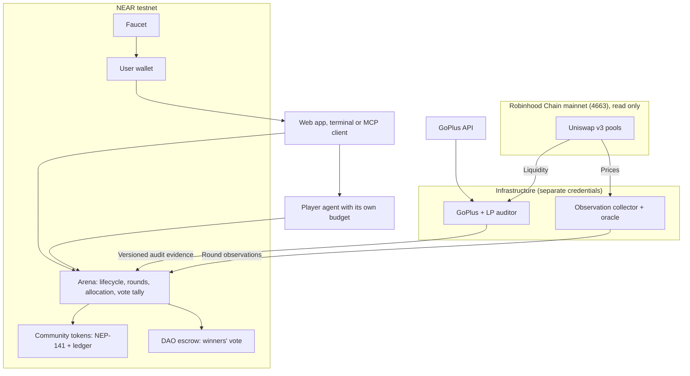
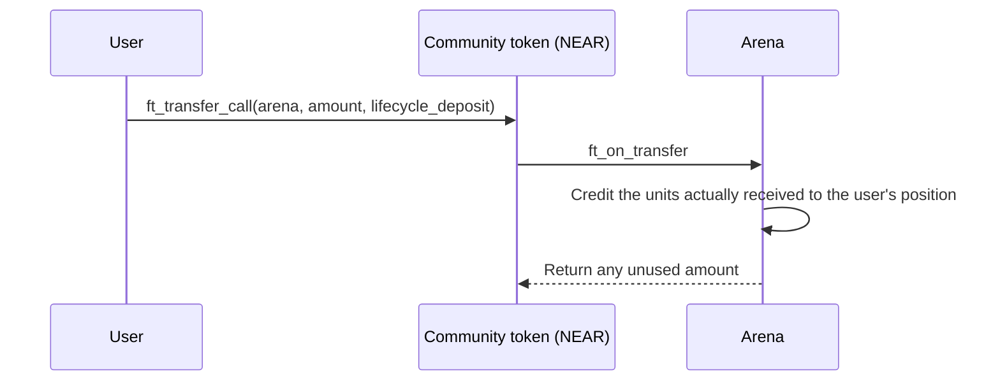
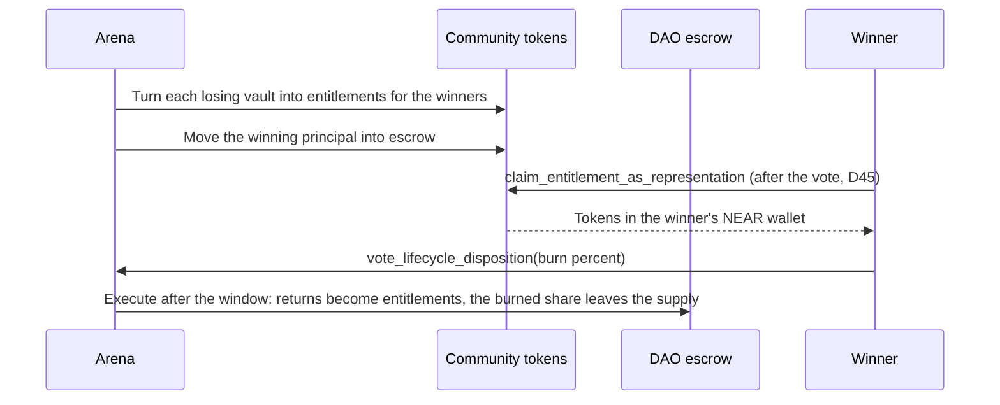

# Architecture

Status: **implemented on NEAR testnet**. [Current-state.md](current-state.md) records what runs today. Product rules live in [product-spec.md](product-spec.md).

## Components and chain boundaries

NEAR runs everything players do: battles, deposits, community tokens, settlement, claims and the winners' vote. Robinhood Chain **mainnet** (4663) is only read: its Uniswap v3 pools give round prices and liquidity, and GoPlus gives token-risk data for each community's mainnet reference token. Nothing is signed for or sent to Robinhood Chain.

| Component | Responsibility | Boundary |
| --- | --- | --- |
| Arena | Multi-community snapshots, creator stake, rounds, exact scoring, per-token allocations, refunds, vote tally | Validates scores instead of trusting a worker's winner label |
| Community tokens (backing) | NEP-141 balances, entitlements, escrow and burns in one ledger per token | Only the arena can allocate or escrow; each unit is consumed once |
| Faucet | Hands out the tokens it holds | Never mints |
| Audit adapter | Reject critical GoPlus findings; independently verify LP > USD 10,000 | Missing required data stays Pending |
| Oracle collector | Point prices, circulating supply, round volume and drawdown samples | No TWAP or fabricated zero observations |
| Scheduler | Submit eligible transitions and resume incomplete work | Late calls cannot move recorded round boundaries |
| Player agent | Execute a user's bounded strategy | Separate identity and budget from infrastructure workers |
| MCP / terminal | Reads, previews and authorized requests | Model output is untrusted input, never a signing grant |
| DAO escrow | Keep winning principal until the winners' vote is executed | Only the contract tally of winner votes decides (D22, [DAO governance](dao-governance.md)) |

## Deposit flow

A deposit counts only when the community has fresh audit and backing approvals and the battle has not started. A deposit after the start is returned. [Token-economics.md](token-economics.md) defines the ledger.

## Scheduler and observations

Identify each round by battle, index, candidate set, mode, policy version and start/end. Persist raw evidence references and normalized observations. Endpoints must match the recorded 30-second interval; volume counters and drawdown peaks reset in overtime.

The arena validates expected state and round ID and records transitions once. Eliminated communities' vaults stay locked until a final winner exists. Missing data holds resolution pending; elapsed time cannot silently settle, refund or cap overtime.

## Settlement, claims and the winners' vote

Rewards are recorded without waiting for the vote. The claim opens once the vote is finished.

## Authority separation

- Freeze asset identity, audit policy and evidence before lock. Tokens and liquidity can be malicious even when an API reports no risk.
- Audit and oracle credentials can submit evidence only for their role; infrastructure cannot move player funds or use player keys.
- Player grants bind user, budget, methods, assets, destinations, expiry and revocation. Enforce token limits in the contracts, not a prompt or browser timer.
- Publish operator, upgrade and emergency powers. No shortcut can bypass DAO escrow or the token ledger.
- TEE provenance does not establish market truth or grant spending authority.

[Security-review.md](security-review.md) tracks threats and evidence gaps. [Interfaces.md](interfaces.md) lists the main calls.
