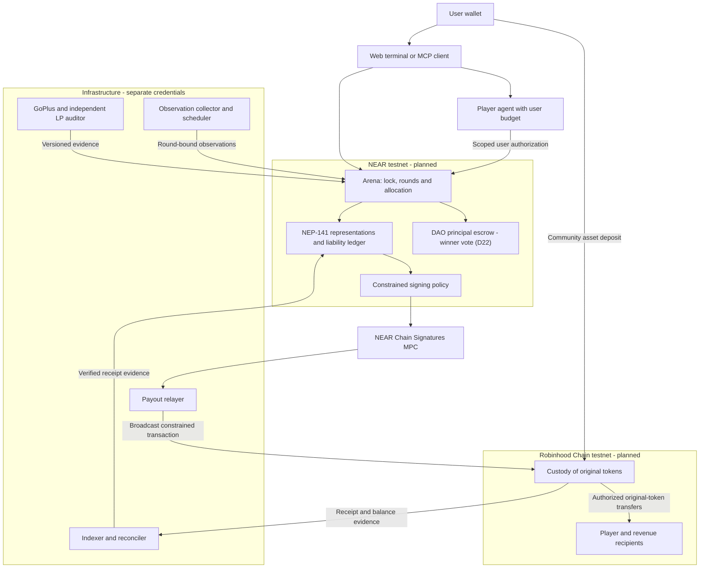
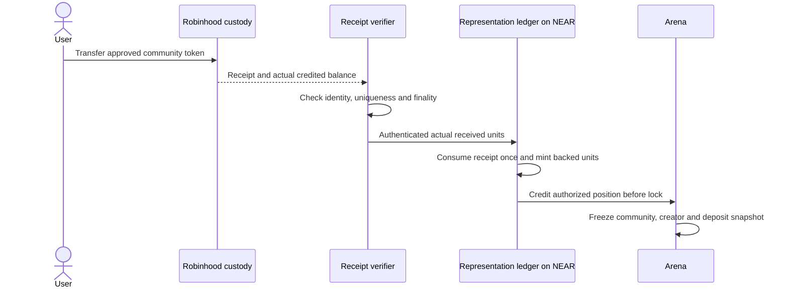
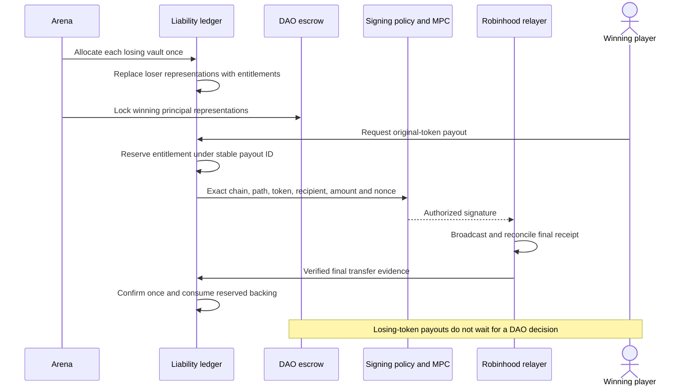

# Target architecture

Status: **planned; no target component is deployed by this PR**. [Current-state.md](current-state.md) records the existing implementation. Product rules live in [product-spec.md](product-spec.md).

## Components and chain boundaries

NEAR coordinates battles and liabilities. Robinhood testnet holds original community assets and receives original-token payouts. "Native-token payout" means the original token contract on Robinhood, not necessarily ETH, the chain's gas coin.

| Component | Planned responsibility | Boundary |
| --- | --- | --- |
| Arena | Multi-community snapshots, creator stake, rounds, exact scoring and per-token allocations | Validate scores instead of trusting a worker's winner label |
| Representation / ledger | Receipt uniqueness, 1:1 mint, exclusive backing reservations and redemption | NEP-141 alone is not a custody proof |
| Robinhood custody | Hold approved assets; execute exact authorized transfers/disposals | Custody and receipt verification mechanism OPEN |
| Audit adapter | Reject critical GoPlus findings; independently verify LP > USD 10,000 | Missing required data stays Pending |
| Oracle collector | Point prices, circulating supply, round volume and drawdown samples | No TWAP or fabricated zero observations |
| Scheduler | Submit eligible transitions and resume incomplete work | Late calls cannot move recorded round boundaries |
| Indexer / reconciler | Replay events, track finality/reorgs, reconcile balances/liabilities | Indexer assertions alone cannot mint or confirm payment |
| Relayer | Fund gas and broadcast authorized transactions | Cannot choose a new recipient, token, amount or player spend |
| Player agent | Execute a user's bounded strategy | Separate identity and budget from infrastructure workers |
| MCP / terminal | Reads, previews and authorized requests | Model output is untrusted input, never a signing grant |
| DAO escrow | Keep winning principal until valid disposition | Only the contract tally of winner votes decides (D22, [DAO governance](dao-governance.md)); not implemented |

## Deposit and representation flow

Arrival after lock cannot amend a live vault. Keep attributed funds recoverable outside that snapshot under a specified refund policy. Duplicate/reorganized receipts cannot create supply. [Token-economics.md](token-economics.md) defines the liability invariant and asynchronous transitions.

## Scheduler, observations and indexer

Identify each round by battle, index, candidate set, mode, policy version and start/end. Persist raw evidence references and normalized observations. Endpoints must match the recorded 30-second interval; volume counters and drawdown peaks reset in overtime.

The arena validates expected state and round ID and records transitions once. Candidate elimination is separate from custody release: eliminated communities' vaults stay locked. Missing data holds resolution pending. Recovery rules are OPEN; elapsed time cannot silently settle, refund or cap overtime.

The indexer needs finalized cursors, block hashes and event deduplication keys. On restart, reconcile chain state before submitting work. Detect reorgs, retract provisional projections and stop affected mint/payment confirmations until finality is re-established. Finality thresholds and the evidence-verification trust model are integration gates, not completed work.

## Settlement and independent payout flow

Chain Signatures provides signatures; relayers broadcast and verifiers check execution. It does not bridge assets, prove deposits or guarantee payment. Signer callbacks and RPC responses require durable reconciliation under the same payout ID.

## Authority separation

- Freeze asset identity, audit policy and evidence before lock. Tokens and liquidity can be malicious even when an API reports no risk.
- Audit/oracle credentials can submit evidence only for their role. Signing policy reconstructs payloads from locked liabilities; infrastructure cannot request arbitrary transfers or use player keys.
- Player grants bind user, budget, methods, assets, chains, destinations, expiry and revocation. Enforce token limits in the authorization/custody layer, not a prompt or browser timer.
- Publish operator/upgrade and emergency powers before acceptance. No shortcut can bypass DAO escrow or exclusive backing reservations.
- TEE provenance does not establish market truth or grant spending authority.

[Security-review.md](security-review.md) tracks threats and evidence gaps. [Interfaces.md](interfaces.md) defines illustrative planned APIs.
