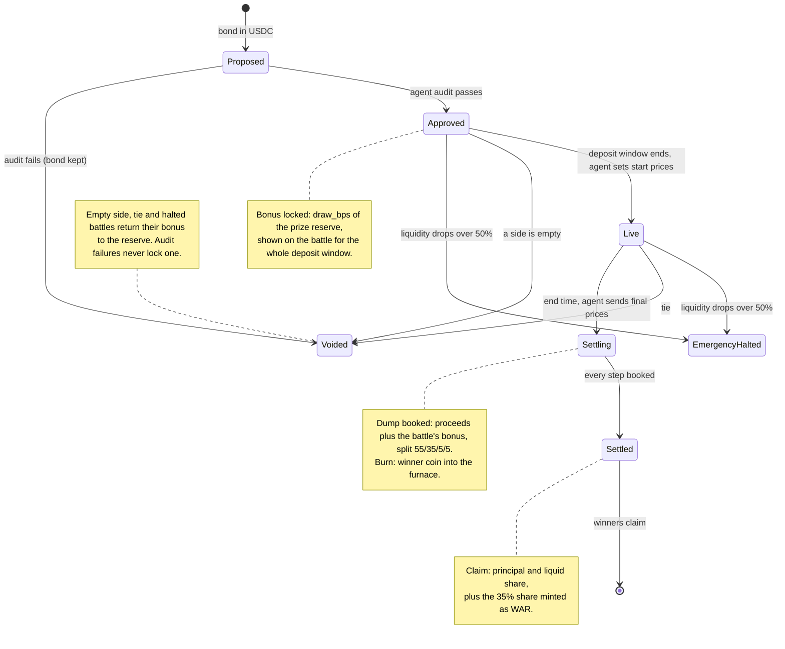
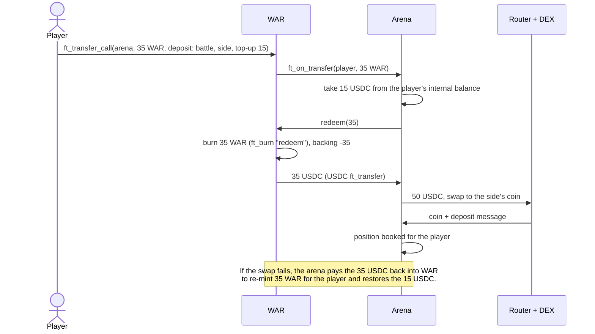
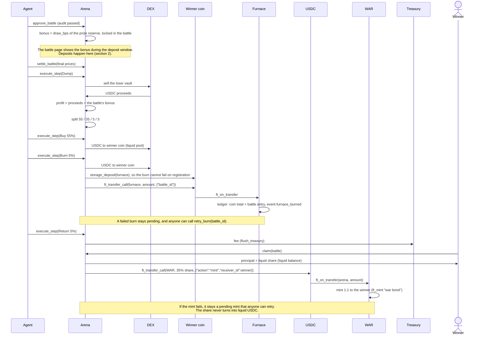
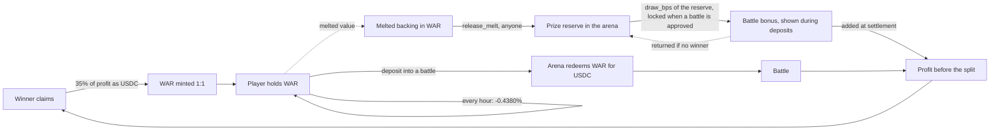

# Flow with war bonds and the furnace

This is the end-to-end flow once both OpenSpec changes are applied: `add-war-bonds` (WAR, the prize reserve) and `add-verifiable-burn` (the furnace, the burn leaderboard). For today's flow, see [architecture.md](architecture.md).

**Status:**
- WAR contract: built (mferdinandr/valtrum#35)
- furnace: not built yet
- arena wiring for both: not built yet

The numbers below follow the specs.

## Who does what

| Part | Role in the flow | Keys after launch |
| --- | --- | --- |
| Player | proposes, deposits, claims, holds WAR | own wallet |
| Arena | battles, vaults, settlement, prize reserve | owner and agent keys |
| Router + DEX | swap USDC into a side's coin, and back at settlement | owner key |
| Agent | audit, lock prices, settle, drive steps, watchdog | agent key |
| **WAR** | war bonds: mint, hourly melt, redeem, release melt | **none** |
| **Furnace** | keeps burned coins forever, keeps the burn ledger | **none** |
| Treasury | receives the 5% fee | treasury key |

## 1. Battle lifecycle

The statuses do not change. What is new is where the prize bonus, WAR and the furnace come in. A battle locks its bonus when it is approved, so players see the bonus before they deposit.

## 2. Deposit with WAR (PRD example: 35 from credit + 15 from the wallet)

The player sends WAR to the arena. The message can top up from the player's internal USDC balance, so mixed funding is one action. WAR is always used in full before USDC.

## 3. Settlement and claim

## 4. The melt loop

WAR melts 4380 ppm every hour (10% per day). The USDC behind the melted value is not lost: anyone moves it to the prize reserve, and every battle that is approved locks a fixed share of the reserve as its bonus. The bonus is shown during deposits and joins the profit at settlement.

## 5. Worked example

Assumptions: the reserve starts empty, and `draw_bps` is 20%. The draw share is still open (to be picked by the simulation), so 20% is only for illustration.

**Battle 1:** PEPE beats SHIB. It was approved while the reserve was empty, so its bonus is 0. The dump realizes 40 USDC.

| Share | Amount | Goes to |
| --- | --- | --- |
| 55% liquid | 22 USDC → PEPE | winner, liquid |
| 35% WAR | 14 USDC | 14 WAR minted to the winner |
| 5% burn | 2 USDC → PEPE | furnace, recorded under battle 1 |
| 5% fee | 2 USDC | treasury |

**Three days later**, the winner still holds the WAR:

| | Amount |
| --- | --- |
| WAR balance | 14 × (1 − 0.00438)^72 = **10.206294 WAR** |
| Melted | 3.793706 USDC (about; the supply rounds up by up to 2 units) |
| After `release_melt` | the prize reserve holds about 3.79 USDC |

**Battle 2**, approved after the release:
- **Approval.** The battle locks 20% of the reserve, **0.758741 USDC**, as its bonus. The battle page shows "+0.758741 USDC bonus" for the whole deposit window.
- **Deposit.** The winner deposits 25 USDC in one action: 10.206294 WAR plus 14.793706 USDC topped up from the internal balance.
- **Settlement.** The battle settles with a dump of 40 USDC. With the bonus, the profit is **40.758741 USDC**:
  - 22.417307 liquid
  - 14.265559 WAR
  - 2.037937 burned
  - 2.037938 fee
- **Reserve.** About 3.03 USDC stays in the reserve for the next battles that are approved. Had battle 2 been halted, its 0.758741 USDC would have gone back to the reserve.

The 3.79 USDC that the winner let melt went back into prizes instead of staying stranded in the arena, which is what happens to expired credit today.

## 6. What the pages show

- **Portfolio:**
  - WAR balance
  - the loss at the next hour, and a countdown to it
  - a deposit action that uses WAR first
- **Battle page:**
  - the battle's bonus, from approval on, so it is visible during the deposit window
  - the amount burned into the furnace
- **Burn leaderboard:** coins ranked by `burned / ft_total_supply`, each with its battle history, the furnace account and its balance.
- **Token pages:** WAR rules from `get_params`, supply, backing and melted backing from `get_state`.

## Trust, in one place

- **Nobody can change** the WAR or furnace rules or code. Neither account has a key.
- **The arena owner can still upgrade the arena.** A malicious upgrade could take the prize reserve and anything in flight inside the arena, or skip future burns. It cannot touch WAR that holders keep, WAR's backing, or coins already in the furnace.
- **The agent still drives approval and settlement.** A bonus is locked when it approves, and the bonus and the burn are paid when it settles. If it stops, WAR keeps melting and the melt can still be released, but no new battle locks a bonus and locked bonuses wait in their battles.
