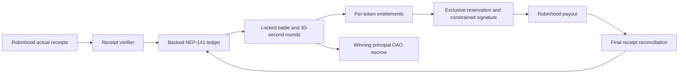

## Context

Status: planned, unimplemented, testnet only. Base source is summarized in [current-state](../../../current-state.md). The proposal supersedes earlier Ref swap settlement, TWAP, bond and credit plans without changing live deployments.

## Goals / Non-Goals

Deliver the permissionless multi-community game with correct original-token custody and payouts, four exact modes, unlimited overtime and bounded user agents. This documentation does not implement code, deploy, merge, select DAO voting rules or migrate WAR/VALT/credit.

## Decisions

1. Snapshot revenue policy and fee recipients at battle creation; freeze community, deposit, creator participation and observation policy before round 1. No bond; every community and creator has a positive backed position.
2. Use fixed 30-second intervals and point observations. Exact formulas, rational comparisons and validity rules are in [battle rules](../../../battle-rules.md). Missing data holds resolution pending.
3. Repeat tied leaders only with fresh score inputs indefinitely; keep all original vaults locked.
4. Collect each losing token's fee as floor(vault * snapshotted_total_fee_bps / 10000); creator receives floor(fee * snapshotted_creator_share_bps / 10000), protocol the remainder, or all fee for protocol-created battles. Defaults are 10 and 5000 bps. Allocate only the winner pool using deterministic largest remainder. Replace its locked representations with exclusively backed entitlements. Keep winner principal in DAO escrow.
5. Separate availability from foreign execution. Reserve before requesting a signature, bind nonce/payload to payout identity, reconcile before retry, confirm only matching final receipt.
6. Separate infrastructure evidence/scheduling/relay roles from user-specific token-spending grants. Model text is never authorization.
7. Apply the selected [GoPlus mapping](../../../goplus-audit.md): critical flag/tax-path rejection, required unknown-data hold and independent LP > USD 10,000. Tax/admin admissibility and evidence freshness remain OPEN.

## Data flow

[Architecture](../../../architecture.md) expands scheduling, indexing and trust boundaries. [Interfaces](../../../interfaces.md) gives planned calls, events, observations, payout records and MCP tools; none is an existing ABI. [Economics](../../../token-economics.md) defines B = M + E + P + D + U and each transition.

## Trust boundaries and failure handling

Custody and receipt verification remain explicit trust/design gates. MPC signs but neither bridges nor proves execution. Oracle sources, circulating supply, volume coverage and cadence require a frozen policy. A TEE cannot make false external data true.

Duplicate requests must be harmless by state/version and receipt/payout identity. On data outage, hold resolution; do not invent zero scores, release eliminated vaults or cap overtime. On missing audit coverage, hold approval. On payout timeout, retain reservation and reconcile broadcast/replacement history. Restore only after proving no spend remains executable. On reorg/deficit, suspend affected mint/payment confirmation and reconcile liabilities. On undecided DAO, hold principal while allowing independent valid rewards.

No user delegation can be exercised by an infrastructure credential. Expiry and token caps require trusted-layer enforcement beyond the legacy browser session policy.

## Testnet strategy

First verify chain 46630, signer address/key/domain, RPC and gas; then prove actual-received mint/redeem and original-token payout. Record code hashes, mapping/policy versions and receipt links. Verify GoPlus coverage and all scoring data over actual 30-second intervals. Fixture-based tests must be labeled and cannot satisfy live integration gates. Follow [roadmap](../../../implementation-roadmap.md).

## Risks / Trade-offs

Short point-observation rounds expose manipulation and latency risks; policy feasibility must be demonstrated. Unlimited overtime and an unresolved DAO can lock assets indefinitely; no arbitrary timeout is introduced. Exact per-token accounting increases payout/reconciliation work. Arbitrary token tax/rebase behavior may require exclusion after policy decisions.

## Migration Plan

Use isolated new testnet deployments after implementation. Existing deployment behavior stays documented separately; no migration of old positions or credit is specified. Do not archive this proposal until required implementation and verification are complete.

## Open Questions

DAO mechanism including membership, weight, quorum, deadlines and fallback; audit tax/admin admissibility and freshness policy (critical fields are mapped); source providers/cadence/boundaries; custody proof/finality/reorg recovery; gathering/cancellation/emergency rules; protocol identity; token limits and gas. The [question register](../../../product-spec.md#open-question-register) is authoritative. No DAO parameters are selected here.

## Configurable revenue amendment

Revenue is adjustable by protocol authority: total fee and creator share default to 10/5000 bps, each within [0,10000] with no additional business cap. Creation-time snapshots override earlier fixed-fee wording and lock-time policy selection: existing battles never inherit later updates. Use the generalized settlement formula; previous 0.1% and equal-split examples remain default-policy examples. Emit versioned policy updates and expose snapshots before deposit.

## Confirmed testnet implementation decisions

- Use an authorized verifier with explicit RPC/finality trust; source receipt evidence alone does not authenticate a NEAR beneficiary or authorize minting.
- Buy/sell tax limits are 5%; transfer tax must be zero. Active privileges to pause transfers, change holder balances/taxes or address lists are ineligible; unknown effective authority is Pending. Mint admissibility and evidence TTL still need explicit configuration.
- Creator chooses the gathering deadline. No live halt/refund is triggered by falling prices or LP. Missing historical round evidence holds resolution Pending without shifting its interval.
- Implement DAO escrow and adapter boundary first. Voting design and live disposition activation remain deferred, so tasks 7.2/7.3 cannot be marked complete solely from escrow tests.
