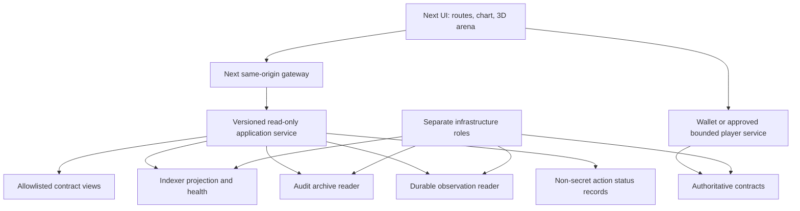

## Context

Coordination reference only. Executable scope/specs/tasks are split across the four
changes in [README.md](README.md); prerequisites retain the owners in
[ownership.md](ownership.md). This file is not a fifth implementation checklist.

This design is proposed against the inspected working tree documented in
[integration-map.md](integration-map.md), not an asserted live deployment. Existing
frontend `ArenaApi` is legacy A/B; lifecycle contracts and selected agent libraries
exist but do not form an end-to-end application runtime. The current 3D arena is
already an adapter over external recorded state and must retain that boundary.

There is no general existing application API server. Reuse the agent's typed,
dependency-light read-service conventions and the frontend's Next route proxy,
`useAsync`, wallet provider and deterministic terminal review patterns. Introduce
a read service because RPC views alone cannot supply backend search, account
aggregates, durable chart samples or cross-contract reconciliation. This is an
intentional new boundary, not a replacement wallet or new frontend framework.

## Goals / Non-Goals

**Goals:**

- Connect current FE, source ABIs and agent processes through testable, versioned
  reads/actions with exact identity, provenance, freshness and explicit capabilities.
- Provide persistent observation history for charts without changing who resolves
  a battle; support lifecycle multi-community integration as its prerequisites finish.
- Preserve legacy funds/actions and expose target reward/principal/payout states
  separately. Make partial outages/restarts/reorgs visible and recoverable.
- Define a staged implementation and testnet evidence gate for each feature.

**Non-Goals:**

- No app implementation, new deployment, live activation, asset transfer, migration
  file generation, database schema change or existing-position conversion in this change.
- No new scoring formula, hard-coded token eligibility, DAO governance decision,
  automatic tie refund, overtime cap or grant of player spending to infrastructure.
- No claim that DexScreener snapshots prove 30-second volume/supply coverage, that
  audit evidence proves custody, or that a signature/broadcast proves a paid reward.

## Decisions

### 1. Split protocols explicitly and use an immutable deployment manifest

Introduce `legacy-v1` and `lifecycle-v2` adapters behind a new application read
interface; keep existing legacy wallet calls in their own adapter. A fixture
deployment is a separate provenance namespace, not a third financial protocol.
Canonical identity is `(network, arenaContract, protocol, battleId)`; the gateway
accepts an allowlisted immutable `deploymentId` resolving that tuple's deployment.
Same numeric IDs from the two contract maps never share caches, routes or actions.

The operator-published manifest binds NEAR network/RPC identity, arena account and
code hash/ABI version, source chain, registry/backing/payout/custody accounts,
mapping/policy versions and supported capabilities. `get_config` alone cannot prove
lifecycle activation: the current ConfigView does not expose that state. Verify it
through approved deployment evidence or add a reviewed versioned capability view.
Missing configuration yields unavailable/read-only state, never automatic mock fallback.

All public DTO IDs, unit amounts and timestamps are decimal strings. Contract U64/
U128 wrappers differ from bare u64 JSON numbers: use lossless decoding or a reviewed
string-safe versioned ABI. Reject already-unsafe numeric JSON; `String(roundedNumber)`
does not recover an ID. Only bounded community indices remain ordinary integers.

Alternative rejected: coercing lifecycle communities into A/B or reusing a bare
battle ID. That mixes economics, breaks 3+ participants and risks signing for another
protocol's battle. Do not auto-probe mutating methods to discover capabilities.

### 2. Read-only application service behind a same-origin gateway

The browser reads proposed `/api/arena/v1/*` routes; the gateway validates input
and calls a fixed server-configured upstream. No request supplies an RPC/upstream
URL, credential, filesystem path or signer receiver. Reuse existing audit report
queries/DTOs through adapters rather than duplicating policy evaluation in Next.
The read process holds no signing keys and does not launch the agent or mutate a
contract while handling a read. Slow providers cannot hold an HTTP query open forever.

Start with bounded polling/delta reads and AbortSignal propagation; SSE is deferred
until hosting/proxy/reconnect behavior is verified. A proposed 2-second FE poll is
a display cadence, not a promise of 2-second provider observations. Pause hidden-tab
polling and use backoff/jitter on transient failure. Server-side sampling is shared
across clients and is never multiplied by the number of open browsers.

Every response carries schema version, deployment/protocol, source identity,
read-model version/cursor, observed/fetched times, chain block/finality where known,
health and completeness. Aggregates retain per-section provenance instead of falsely
claiming RPC, audit and chart data were one atomic snapshot. See [api-contracts.md](api-contracts.md).

Alternative rejected: browser calls directly to privileged agent endpoints or
arbitrary providers. It spreads keys/CORS/rate limits, cannot safely aggregate status,
and encourages client-side searches over full datasets.

### 3. Backend owns search, pagination and account aggregates

Replace the FE's fetch-all/filter loop with bounded battle queries. Reuse the audit
reader convention: default page size 20, cap 100, opaque cursors and explicit invalid
query errors. Cursors bind deployment/protocol, filter/sort digest and snapshot/cursor
version; a changed filter resets pagination. Search by battle ID, trusted token
identity/symbol and creator is evaluated on backend data. Token dropdowns use the
same pattern, not a downloaded entire registry.

FE text requests debounce 300 ms, abort superseded requests and reject late responses
using request generation plus namespace/query identity. Existing `useAsync` suppresses
stale result assignment but does not pass an AbortSignal; extend/reuse its owning
pattern deliberately instead of assuming cancellation already exists. Empty result,
upstream unavailable and incomplete indexer coverage are different states.

Public on-chain positions remain public data. Account filtering is not ownership
proof. Private previews, delegation state, off-chain intent logs and non-public
action status require a wallet-bound authenticated session; no such server auth
surface is implemented today. Authentication conveys identity, not token-spend authority.

### 4. Wire lifecycle workers as separate roles

Keep the legacy TWAP loop for legacy deployments. Add an explicitly configured
lifecycle runtime that shares typed readers but cannot accidentally run legacy
lock/settlement methods against a lifecycle-exclusive deployment.

| Role | Reads / writes | Integration rule |
| --- | --- | --- |
| Market collector | Provider data → immutable observation archive | No wallet or arena mutation authority required |
| Auditor | Mainnet reference GoPlus/LP → reports and audit submission | Inject existing archive sink in main; do not replace with legacy heuristic |
| Custody verifier | Source receipts/finality/balance → registry attestation | Operator assertion under reviewed trust model, not a browser proof or bridge |
| Backing/lock trigger | Trusted representation views and audit evidence → eligible checks/lock | Contract revalidates backing, expiry, creator stake and immutable mapping |
| Oracle/scheduler | Frozen policy + persisted complete evidence → start/open/submit lifecycle rounds | Own oracle credential; recorded boundaries and candidates survive late scheduling/restart |
| Allocation trigger | Recorded winner/progress → idempotent settlement batches | No worker-chosen winner, beneficiaries or fees |
| Relayer/reconciler | Existing reservation/signing payload/receipts → permitted relayer transitions | Existing reconciler does not initiate requests or hold operator confirmation authority |
| Confirmation operator | Independently verified finalized payout evidence → guarded confirm/revert/restore | Separate process/key/policy; no generic FE invocation |
| Player agent | One user's canonical action + enforced scoped grant | Distinct identity/budget; infrastructure credentials are rejected |

Round worker sequence: persist interval/policy/candidate identity; collect/persist
source evidence; submit only a complete mode-specific envelope; reconcile transaction
outcome and reread authoritative state; publish recorded result. On restart read
chain before new work. Missing close evidence stays pending. Do not shift boundaries
to the retry time or reconstruct vanished samples as zero. A published provisional
chart leader cannot be fed into this pipeline as an oracle answer.

Reuse source `audit/lifecycle-pass.ts`, `custody-verifier.ts`, `payout-reconciler.ts`
and indexer components as primitives. Their existence is not runtime wiring: define
and verify transports, durable stores and process identities for each missing edge.

### 5. Persist chart observations with scoring provenance

Use the same trusted asset/reference mapping for audit and scoring. Mainnet reference
chain 4663 and actual testnet asset chain 46630 have different purposes; a mainnet
price must never be presented as the testnet token's own trading market. Current
`createMarketData` must explicitly receive reviewed chain/aliases before any Robinhood
claim; its default `near` reader is insufficient.

Persist before publication: deployment, protocol, battle, round, community/asset
identity, reference mapping, mode, frozen policy hash, source/pair/quote, scheduled
interval, provider observed time (nullable), acquisition time, source block/hash
(nullable), scaled values, coverage/quality and evidence hash. Never label the local
fetch time as an exchange/block observation timestamp. Deduplicate stable evidence;
record revisions/conflicts instead of overwriting canonical evidence.

Start with a bounded append-only observation journal plus atomic manifest/checkpoint,
following current file-store conventions. Readers query by battle/round/community,
time bounds and opaque cursor. Enforce storage and query limits; a full/corrupt store
degrades service rather than silently dropping evidence. A future SQL store is a
separate reviewed option; obtain explicit approval before generating migration files,
and separate approval before applying schema changes. This proposal creates neither.

Legacy chart normalization uses its recorded contract baseline, including TWAP
semantics. A spot movement against a TWAP baseline is labeled accordingly; it is
not a target 30-second point-price score. Lifecycle charts use fresh per-round
baselines and exact signed rational comparisons on backend; FE floats are display only.
Missing samples create line gaps. No synthetic interpolation is evidence, and an
overtime reset cannot merge with the previous round or unlock eliminated vaults.

| Mode | Required source coverage | Gate |
| --- | --- | --- |
| Price gain | Valid start/current/end point prices and quote scale | Provider and interval/boundary policy verified |
| Market cap growth | Point price and circulating supply with explicit definition/time | No substitution of FDV or price-only growth |
| Volume / initial cap | Deduplicated eligible trades within exact interval plus initial cap | Rolling 24h volume is insufficient |
| Lowest drawdown | Ordered valid point samples with cadence/gap/end coverage | Missing observations are not zero drawdown |

Release price chart reads first if evidence is adequate. Other modes remain unavailable
until their providers satisfy the frozen policy. This staged UI release does not
relax the product requirement to demonstrate all four target modes for full acceptance.

### 6. Complete read/event coverage before rich lifecycle UI

`LifecycleView` exposes communities/locked/principal fields, not a legacy-style
status/deposit deadline. `RoundView` exposes only current ID/candidates/window/winner.
Its private history stores outcomes without complete score/window/sample records.
No current RPC can supply historical exact scores simply by renaming that helper.

Propose reviewed versioned views/events for capabilities, readiness/expiry, round
history and evidence/result references; capture exact rational scores with canonical
round identity when resolving. This may require contract-state/event changes and
new testnet deployment, owned by contract implementers. Unknown historical data stays
unknown; do not pretend new events backfill old evidence. Preserve contract receipt/
block provenance and finality on all derived records.

Extend indexer parsing/projection in coordination with emission/version rollout. The
current engine intentionally degrades on unmodeled relevant events; broad acceptance
without a reducer would hide missing state. Add a verified live BlockSource before
calling projections live. A recorded-import CLI remains fixture/replay evidence.
Contract views can fill current state with separate provenance, not manufacture
missing history. Health/reorg retractions propagate through the read service and FE.

### 7. Keep wallet actions and asynchronous financial states explicit

Lifecycle creation: select two or more distinct registry-bound assets and one mode;
review actual NEAR storage payment; wallet calls `create_lifecycle_battle`. Storage
registration is not creator participation. Creation alone does not start a round.

Source-backed deposit: configured EVM custody call binds beneficiary, battle, mapping
version and refund address; trusted verifier/registry validates finalized actual
received units; user pulls `claim_receipt`; register FT/position storage as needed;
claim own attributed representation; transfer configured representation via
`lifecycle_deposit`; verify credited position. Every step has a durable identity and
pending/rejected/confirmed state. Support already-backed representations as a shorter
path, without pretending every user must bridge again. Late receipts retain their
specific recoverable balance/refund path and do not amend locked snapshots.

Settlement/portfolio: display separate per-token available entitlements, reservations,
payout attempts, late balances and principal hold. Use backing/payout views and indexed
allocation references. Snapshot reconstruction is not a new allocation transaction.
Do not derive lifecycle rewards with legacy `previewClaim` or show 55/35/5/5 credit.
No DAO return/burn control is enabled until its owning requirement is resolved.

Payout: wallet requests a stable request ID/beneficiary/backing/amount/destination;
exclusive backing reservation precedes signature. Show `authorized`,
`signing_requested`, `signed`, `broadcast`, `pending_finality`, `reverted`,
`reconciliation_required`, `confirmed`, `restored` distinctly. Broadcast is not receipt;
restored is not paid. Reconcile the same request/nonce/attempt after timeout before
considering another request. The existing relayer deliberately cannot confirm/revert/
restore as operator; implement that boundary explicitly, never remove it for FE convenience.

### 8. Share canonical actions with Terminal and future MCP

Add typed read-only previews binding protocol/deployment, wallet identity, assets,
units, recipients, method/receiver, expected state/round/mapping/policy versions,
costs, expiry and stable action ID. A parser returns an untrusted intent, not this
authorization. Revalidate before signing and after submission; callback resolution
or tx hash alone is not verified position/payout credit. Abort/stale-preview outcomes
never silently switch networks, methods, amounts or destinations.

Current browser function-call keys retain their documented legacy scope/risks. Do
not reuse their app-only expiry/gas estimate as lifecycle token-budget enforcement.
Future MCP/player agents use the same canonical preview/status layer only after
server/contract-enforced grants, revocation and concurrent-budget reservation exist.
Unsupported Intents/Bitte/testnet routes report unavailable and submit no fallback
funds. Keep operator tools out of the user-action method allowlist.

## Risks / Trade-offs

- Mixed protocol caches or unsafe u64 → immutable namespace + string-safe ABI/decoder
  and tests above 2^53; reject rather than silently coerce.
- Market data exists but does not cover 30-second evidence → per-mode capability and
  provider qualification, raw provenance, missing/stale UI and pending resolution.
- File stores outgrow limits → bounded snapshots/archives and visible degraded health;
  review a scalable backend before growth exceeds budget; no unapproved schema work.
- Multiple services yield inconsistent snapshots → per-section source versions,
  compatible state barriers and direct authoritative revalidation before writes.
- New events degrade an old indexer → coordinated schema/reducer rollout and replay
  fixtures; stop on unsupported relevant events instead of ignoring them.
- A central read service adds latency/failure → cache public immutable metadata,
  bounded delta polling and partial availability; never infer confirmed funds from cache.
- Operator/verifier/oracle trust remains → explicit independent roles, disclosed
  powers and live evidence; health/TEE metadata is not external-market truth.
- DAO and provider decisions unresolved → hold dependent capabilities unavailable;
  no invented governance, automatic release or synthetic final result.

## Migration Plan

1. Record source/deployment ABI and role manifest; freeze DTO/API fixtures and source
   namespace. Do not activate lifecycle or migrate contracts as a discovery step.
2. Ship read-only gateway, backend queries, audit archive wiring and durable chart
   observation delivery for verified sources, keeping all writes on existing adapters.
3. Complete live indexer/round evidence/views and workers on isolated testnet; capture
   actual receipts, code hashes, source/finality and restart/reorg evidence.
4. Enable lifecycle reads/3D/chart only when supported, then creation/deposits, then
   entitlement/payout workflows after their respective acceptance gates.
5. Integrate Terminal and later MCP/player actions only after authorization gates.
   Preserve legacy access for old positions; never rewrite old economics or identities.
6. Roll back by disabling new capabilities and user action entry points, retaining
   read access and in-flight receipt/payout reconciliation. Do not delete journals,
   reset cursors or abandon obligations when rolling back UI/service versions.

No database migration is authored/applied here. Future migration generation and
application require separate explicit approvals under the repository instructions.

## Open Questions

- Exact deployed accounts/code hashes, lifecycle activation, custody domain and signer
  configuration must be verified; source presence is not a release manifest.
- Target provider identity, cadence, caching, supply definition, interval volume,
  quote conversion, boundary tolerance and availability on reference chain 4663.
- Production live indexer provider/finality policy and operator confirmation service.
- New view/event/state version deployment and historical evidence backfill availability.
- Production storage sizing/retention/privacy and high-availability single-writer strategy.
- User-facing EVM signing transport and exact verified custody/refund UX on chain 46630.
- DAO governance and live token-policy-change recovery remain in the owning OPEN
  registers; this integration does not decide them.
