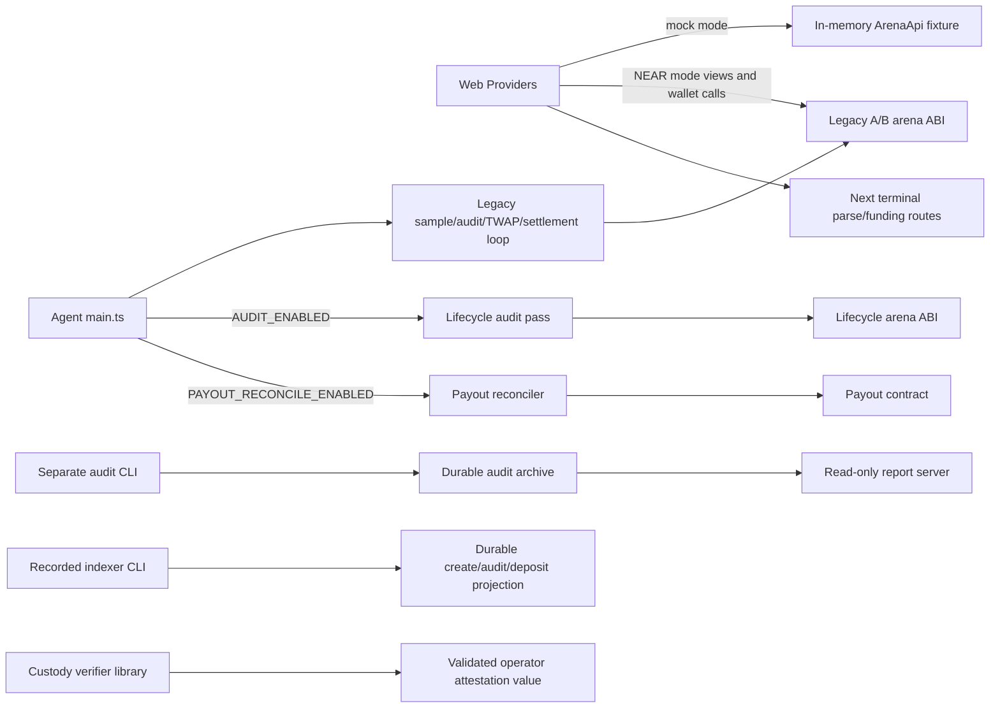

# Frontend, contracts and agent integration map

This is the pre-merge inventory. [Main reconciliation](main-reconciliation.md)
identifies newer archive/MCP/indexer/governance implementations to reuse.

## Evidence scope

Inspected 2026-11-10 on `feat/living-toy-world`, HEAD
`4881fd76570a060659cafa7a4275e8740a5cdaf4`, plus the current dirty working tree.
The integrated 3D arena, charts and revised characters are working-tree changes
at inspection time. This is a source investigation, not a deployment/RPC/provider
verification, security audit or claim that existing task lists are complete.
`docs/current-state.md` describes an older base; it is historical context, not the
complete inventory of the files below.

Source paths below are relative to the repository root. “Present” means source
exists; “wired” means an inspected entry point calls it. Neither means deployed.
Untracked `agent/src/arena-audit.ts`, `arena-liquidity.ts`, `goplus-audit.ts` and
their edits to `index.ts` are provisional local work, not the production wiring
used as the basis for this proposal.

## 1. Current execution graph

There is currently no general HTTP application backend between FE and agent.
The Next terminal routes, agent health server and separate audit report server
are different surfaces. Source contracts are the authoritative backend for funds.

## 2. Frontend surface ownership

| Surface / source | Present behavior | Missing integration / required destination |
| --- | --- | --- |
| `web/src/lib/config.ts`, `components/providers.tsx` | Missing arena ID selects mock; NEAR mode builds legacy ArenaApi and wallet bridge | Explicit protocol/network/deployment manifest, isolated fixture mode and lifecycle adapter; no failure fallback to mock |
| `lib/arena/types.ts`, `near.ts` | A/B DTO, numeric battle IDs; direct `get_battle`, `get_battles`, position/config/balance/plan views | Versioned DTOs, string IDs, dynamic communities, round/audit/backing/payout views |
| `app/arena/page.tsx` | Fetches every battle in pages of 100, then searches/filters in the browser | Backend search/status/creator/token filters and cursor pagination; debounced/cancelled requests |
| `app/battles/new/page.tsx` | Two token IDs, duration, USDC bond | Lifecycle asset mappings and one mode; NEAR storage review, no bond; creator participation tracked separately |
| `components/deposit-form.tsx`, `kinetic/battle-deck.tsx` | Existing token/USDC/balance/credit deposits and verified position-credit feedback | Lifecycle registration/representation transfer path and source-receipt progress; preserve legacy locks and reviews |
| `app/battles/[id]/page.tsx` | Legacy snapshot reads and periodic reload; multi-community branch is demo-only | Lifecycle aggregate, current round/candidates, data readiness, confirmed result and settlement progress |
| `colosseum/battle-runtime.ts`, `battle-arena.tsx` | 3D renderer consumes legacy BattleView; no standalone Play 3D route | Consume versioned read model; preserve external authoritative rounds and cosmetic-only selection/pause |
| `battle-chart/snapshots.ts`, `chart.tsx` | Disconnected initial/available/final snapshots; no fabricated historical line | Persisted round samples, provenance, quality/gaps and data-source-correct baselines |
| `colosseum/score-series.ts` | Synthetic display series on the multi-community demo clock | Keep isolated fixture provenance; never relabel as live or use for settlement |
| `app/portfolio/page.tsx`, `lib/arena/payout.ts` | Legacy liquid/credit and 55/35/5/5 estimates, claim/refund then withdraw | Lifecycle positions, separate losing-token entitlements, reserved/in-flight payouts, late balances and principal hold |
| `lib/terminal/*`, `app/terminal/page.tsx` | Rule/optional LLM intent parsing, deterministic transaction review and legacy sender | Shared versioned action previews/status; lifecycle handlers; bounded player grant service remains a prerequisite |
| `app/api/terminal/parse/route.ts` | POST parser route, server-only optional NEAR AI credentials | Parser is not authorization or an MCP server |
| `app/api/terminal/funding/route.ts` | Validated POST proxy for quote/commit/status of configured 1Click service | Verify selected testnet routes and received custody independently; no generic bridge assumption |
| `lib/terminal/session-key.ts` | Restricted methods/receiver/gas; app-only expiry, secret in tab sessionStorage | Do not present as on-chain token budget or expiring player grant; revoke on chain |
| `colosseum/characters.json` | Five cosmetic demo identities; four listing-reviewed images, WIF unverified | Trusted chain/contract/representation/reference registry; generic emblem for unknown identity |

## 3. Actual source ABI and call paths

These method names are inspected source, not the illustrative names in
`docs/interfaces.md`. ABI availability and deployment identity still need verification.

| Domain | Actual public method(s) / input | Caller / frontend use | Gap |
| --- | --- | --- | --- |
| Legacy reads | `get_config`, `get_battle_count`, `get_battles`, `get_battle`, `get_position`, `get_account`, `get_liquid_balance`, `get_settlement_plan` | Existing frontend and agent | No market-history API; legacy IDs include bare JSON numeric u64 fields |
| Legacy actions | USDC `ft_transfer_call` with `propose`; coin `ft_transfer_call` with `deposit`; `deposit_from_balance`, `claim`, `withdraw_initial_deposit`, `withdraw_liquid` | Existing wallet/session sender under current contract checks | Must stay legacy-only; do not reuse bond/credit settlement for lifecycle |
| Lifecycle creation | `create_lifecycle_battle(assets, mode)` | User wallet; actual NEAR storage deposit, no USDC bond | Frontend missing; lifecycle must be activated/configured by operator beforehand |
| Lifecycle discovery/position | `get_lifecycle_battle_count`, `get_lifecycle_battle(battle_id)`, `get_lifecycle_position(battle_id, community, account)` | Read-only service and account views | Audit expiry already exists as `communities[].audit_expires_at_ms`; no filtered list, activation/config readiness or complete lifecycle phase DTO; position is registered/amount, not rich portfolio state |
| Registration and deposit | `register_lifecycle_position(battle_id, community)`; representation `ft_transfer_call` to arena with `{"action":"lifecycle_deposit","battle_id":...,"community":...}` | User wallet; registration is storage, not stake | Need representation storage/balance reads, confirmed receipt attribution and post-credit verification |
| Audit and lock | `submit_lifecycle_audit`, `refresh_lifecycle_backing`, `lock_lifecycle_battle` | Authenticated auditor/backing checks and eligible trigger; contract validates locks | UI must not use an audit icon or a report alone as proof of backing/lock readiness |
| Round start/resolve | `start_lifecycle_rounds`, `open_lifecycle_round`, `submit_lifecycle_observations` | Frozen-policy setup and oracle-authorized writes | No target round scheduler/provider pipeline wired in `main.ts` |
| Round view | `get_lifecycle_round(battle_id: U64)` | Read service | Returns round ID/candidates/start/end/winner, not exact scores, historical rounds, pending reason or raw observations |
| Allocation | `settle_lifecycle_battle(battle_id: U64, max_entitlements)`, `get_settlement_progress` | Permissionless eligible batched call with storage funding; read cursor | `settlement_plan` is an internal Rust helper, not an exported JSON view; do not call it as RPC |
| Source receipt | `ReceiptRegistry.attest`, `get_active_claim`, `get_claim`, `dispute`, `is_disputed` | Verifier-only attestation; public reads | Need configured live verifier/operator transport and evidence pipeline |
| Backing receipt/representation | `claim_receipt(transaction_hash, log_index)`, `claim_representation(beneficiary, amount)` | Storage-funded pull of attested receipt; owner-attributed representation claim | Credit only verified actual received units; `claim_representation` is not permission to claim another account's balance |
| Backing account/health | `entitlement_of(account)`, `unallocated_balance_of`, `source_residue_of`, `late_balance_of`, `late_balance_of_refund`, `get_asset`, `get_ledger`, `get_custody_ledger`, `get_suspension` | Read-only adapters per backing | No existing FE aggregate across assets/accounts; unknown/unconfigured remains unavailable |
| Payout request | `request_payout(backing, request_id: [u8;32], amount: U128, destination: [u8;20])` | Beneficiary wallet; storage funding and exclusive reservation | FE has no target action/status adapter; stable request ID must survive retry |
| Late refund | `request_late_refund` and backing late-balance views | Beneficiary or specifically constrained operator; source refund address is bound at deposit | Must not invent a new destination or release a live losing vault |
| Payout reads | `get_payout_status`, `get_payout`, `list_open_payouts`, `get_payout_count` | Read service/reconciler | `list_open_payouts` is not a complete account-scoped historical portfolio API |
| Signer/relayer/operator | Payout `request_signature`, `record_broadcast`, `record_pending_finality`, `require_reconciliation`, `confirm_payout`, `record_revert`, `restore_payout` | Different role checks; inspect contract per method | Never expose privileged calls as generic FE POST actions or give every worker one operator key |
| DAO | Lifecycle `principal_community` / `principal_amount` fields | Display held principal only | No invented voting/return/burn UI; governance remains OPEN |

Sources: `contracts/arena/src/{lib,lifecycle,lifecycle_backing,rounds_api,settle_api}.rs`,
`contracts/backing/src/lib.rs`, `contracts/payout/src/contract.rs`,
`contracts/receipt-registry/src/lib.rs`, `evm/src/TestnetDepositCustody.sol`.
Only exported `#[near]` methods are callable; pure helpers and test fixture methods
are not production RPC APIs. Some ABI fields are bare Rust u64 JSON numbers, while
U64/U128 wrappers encode strings; a new boundary must preserve/reject unsafe values
before ordinary JSON number parsing loses precision.

## 4. Agent/process wiring

| Component | Present source and wiring | Integration consequence |
| --- | --- | --- |
| Runnable agent | `agent/src/main.ts` calls `runOnce` in `runtime.ts` | Legacy sample → heuristic audit → TWAP lock → settlement/steps/watchdog remains primary loop |
| Lifecycle audit | `audit/lifecycle-pass.ts`, optional `AUDIT_ENABLED`; optional `AUDIT_LOCK_ENABLED` | Already calls lifecycle ABI, separately from legacy audit; share only normalized evidence, not heuristics |
| Audit reports | `audit/report-archive.ts`, `report-query.ts`, `report-server.ts`, separate report CLI | Durable archive + GET/HEAD `/audit-reports`, `/:evidenceHash`, `/:evidenceHash/text` exist; `main.ts` supplies RAM report store but no archive sink, so serving a directory does not make live reports appear |
| Market | `market-wiring.ts`, `twap.ts`, `mockdex-market.ts`, `ref-market.ts` | Price samples accumulate in RAM. Main DexScreener construction uses default chain `near` and no aliases even though reader supports chain/alias options; audit reference registry is not automatically shared with pricing. Reader address matching is literal, so EVM checksum/lowercase normalization also needs an explicit adapter rule |
| Legacy timing | `market-config.ts`, `runtime-config.ts` | Default 30-second pass / 1800-second TWAP is not a complete 30-second point-observation policy for target modes |
| Target market evidence | Contract mode/scoring inputs exist | No wired circulating-supply provider, interval trade-volume collector, target scheduler or durable chart history API found |
| Indexer | `indexer/{engine,store,parser,projection,recorded-source,cli}.ts` | Durable read-only replay/reorg foundation with recorded import; no wired live BlockSource/HTTP application service; allowlist currently only creation/audit/deposit events |
| Indexer coverage | `indexer/types.ts`, `projection.ts` | Does not expose a round/score/payout projection. New unknown events currently degrade/quarantine; coordinate event/schema version rollout |
| Custody verifier | `custody-verifier.ts`, `custody-event.ts`; EVM testnet custody contract | Verification library produces operator assertions from receipt/finality/balance evidence; not a wired, public deposit-ingestion endpoint or cryptographic bridge. `TestnetDepositCustody.sol` explicitly has no withdrawals/recovery: it is deposit-only test support, not a demonstrated MPC-spendable payout path |
| Payout | `payout-status.ts`, `near-payout-client.ts`, `payout-reconciler.ts`, optional main wiring | Restart reconciliation exists. It does not initiate user requests, create signatures or hold the operator key; confirmation/revert/restore authority deliberately absent from this worker |
| Health | `health.ts`: `/healthz`, `/readyz`, `/attestation` | Existing health is aggregate loop health/public metadata, not proof of oracle coverage, backing, MPC attestation or confirmed payouts |
| Player agents/MCP | Planned changes and current terminal/session code | No runnable bounded player/MCP integration found; infrastructure worker is not a player agent |

## 5. Gap order and dependencies

| Priority | Gap / decision | Owner | Evidence to finish |
| --- | --- | --- | --- |
| P0 | Deployment manifest, explicit protocols, safe ID/amount encoding | Integration + contracts | Known contract/code hashes/network, source ABI vs deployed ABI comparison |
| P0 | Read-only application query service + Next gateway | Backend + FE | Contract read fixtures, filtered/cursor endpoints, provenance/freshness/error tests |
| P0 | Audit archive wired to real lifecycle pass | Agent | Real pass append visible through existing report server, no demo archive mixing |
| P0 | Durable observation collector/API, correct reference identity | Agent + backend | Restart retains ordered samples; mainnet reference/testnet source roles explicit |
| P1 | Verified target observation policy/providers and scheduler | Oracle + contracts | All four modes with boundary/coverage evidence, repeated ties, outage/restart |
| P1 | Live indexer source and missing views/events | Indexer + contracts | Canonical replay, unsupported-event upgrade, reorg/health propagation |
| P1 | Lifecycle creation/deposit adapter | FE + custody/backing | Actual storage/receipt/credited-position sequence, late arrival and duplicates |
| P1 | Entitlement/settlement/payout portfolio | FE + payout/backend | Independent balances/reservations/confirmations; no duplicate spend on retry |
| P2 | Terminal canonical action boundary and MCP/player grants | Terminal + authorization | Deterministic previews, idempotent status and externally enforced user budgets |
| OPEN | DAO governance, live token-policy changes, provider feasibility | Existing product owners | Resolve only in owning changes; gate dependent controls meanwhile |

The design is a sibling reference; [ownership.md](ownership.md) links canonical
implementation tasks in the split/owning changes. This mapping
does not authorize contract activation, deploying/upgrading services, sending funds,
creating/applying database migration files or changing a running database schema.

The [crosscheck and apply gates](crosscheck.md) records the second source review,
including the deposit-only custody blocker and GitHub closure-state limitations.
