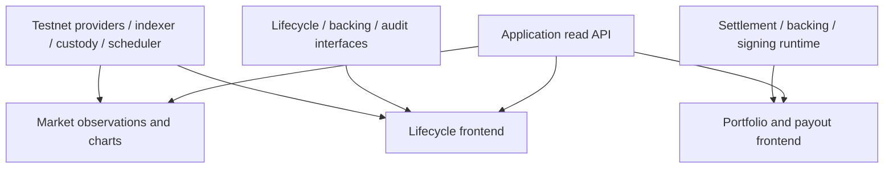

# Integration ownership and handoffs

This plan has no executable task list. Each implementation belongs to one canonical
change; prerequisite links are handoffs, not duplicate checkboxes. Existing completed
tasks retain their historical status. Newly discovered runtime gaps are explicit
unchecked follow-ups in their original owner, not evidence that deployed integration
already exists.

## Execution dependencies

Shared DTOs stabilize first. Chart and lifecycle client work can then proceed
independently. Portfolio reads can start from API fixtures without waiting for
charts or lifecycle UI; financial release waits for the relevant contract/worker
evidence. Canonical MCP previews and delegated player execution remain independent.

## Canonical task owners

Former umbrella group numbers below are historical traceability only; the deleted
66-task umbrella is not a second checklist and must not be used for apply/archive.

| Former group / responsibility | Canonical task list | Required handoff |
| --- | --- | --- |
| 1.1–1.5, 2: manifest, DTOs, reads, search, gateway | [Read API](../../changes/arena-application-read-api/tasks.md) | Safe ABI and canonical read model from owners below |
| 1.6: storage design/approval | Relevant producer change | Market journal is file-backed initially; any database migration generation and application require separate explicit approvals |
| 3.1, 3.4–3.5: archive producer/runtime | [Audit](../../changes/arena-audit/tasks.md) | Persisted report location, identity, restart and failure evidence |
| 3.2–3.3: report reader/client adapter | [Read API](../../changes/arena-application-read-api/tasks.md) | Consume producer archive without granting approval authority |
| 4.1–4.4, 4.6–4.8: journal, history and charts | [Market observations](../../changes/arena-market-observations/tasks.md) | Qualified mapping/input evidence; persisted reader interface to scheduler |
| 4.5: provider qualification | [Testnet integrations](../../changes/arena-testnet-integrations/tasks.md) | Per-mode cadence, boundaries, supply/volume/price definitions and live evidence |
| 5.1–5.2: new contract views/state/events | [Lifecycle](../../changes/arena-lifecycle/tasks.md) | Reviewed ABI and deployment/backfill limits; preserve [scoring requirements](../../specs/arena-scoring/spec.md) |
| 5.3–5.5: live block source and reducers | [Testnet integrations](../../changes/arena-testnet-integrations/tasks.md) | Canonical cursors, finality, retraction and coverage health |
| 5.6–5.9: scheduler, oracle/provider and end-to-end runtime | [Testnet integrations](../../changes/arena-testnet-integrations/tasks.md) | Frozen interval evidence, restart reconciliation and separately authorized oracle |
| 6.1–6.3, 6.5–6.9: lifecycle wallet/arena client | [Lifecycle frontend](../../changes/arena-lifecycle-frontend/tasks.md) | Verified contract/backing/audit interfaces and custody attestation |
| 6.4: custody verifier transport/registry attestation | [Testnet integrations](../../changes/arena-testnet-integrations/tasks.md) with [backing](../../changes/arena-asset-representation/tasks.md) authority | Real actual-received/finality evidence; trusted operator boundary disclosed |
| 7.1: allocation economics and contract trigger | [Settlement](../../changes/arena-settlement/tasks.md) | Client may call only eligible exported batch methods and read progress |
| 7.2–7.4, 7.6–7.8: account reads and payout client | [Portfolio/payout frontend](../../changes/arena-portfolio-payout-frontend/tasks.md) | Entitlement/reservation views and confirmed worker status |
| 7.5: signature initiation and confirmation runtime | [Chain signatures](../../changes/arena-chain-signatures/tasks.md) | Signer/relayer/confirmation-role separation and finality proof |
| 8: canonical previews, MCP, identity/grants/budgets | [MCP/terminal](../../changes/arena-mcp-terminal/tasks.md), [player agents](../../changes/arena-player-agents/tasks.md) | MCP owns preview/action interface; player owns authorization; testnet owns live Intents/Bitte acceptance |
| 9: validation and release | Each implementing change for local checks; [testnet integrations](../../changes/arena-testnet-integrations/tasks.md) for cross-service acceptance | Recorded fixtures and live evidence reported separately |

## Review boundaries

- Read API completion does not require observation, account-action or canonical preview endpoints. Those are downstream extensions with their own task owners.
- Audit owns report production; read API owns consuming it. Market owns evidence persistence; testnet owns provider qualification and scheduler/oracle submission.
- Lifecycle owns new view/state/event ABI. Testnet owns compatible live indexing. A new view cannot reconstruct exact historical scores/window evidence that was never stored.
- Financial contracts own custody, settlement and reservation invariants. Frontend owns eligible wallet preparation and presentation. Signing infrastructure never gains player spending authority.
- Existing MCP/client-wiring and testnet state-display tasks are cross-service acceptance dependencies; the concrete UI implementation is in the relevant child change above.
- Preserve decided audit policy and OPEN DAO/provider/recovery decisions. Do not add an owner-only principal release shortcut to make a demo complete.
- Review source changes, recorded verification and actual network receipts separately. No browser testing is added by this documentation split.
